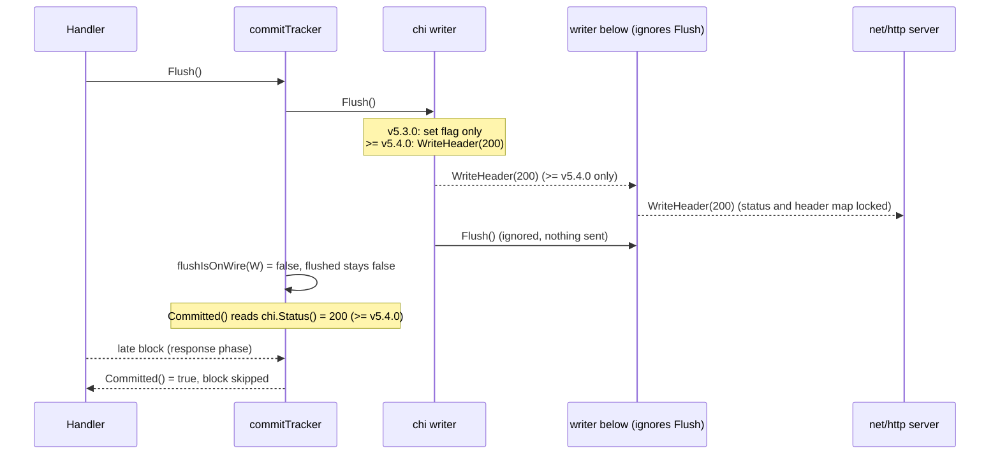

# Design: AppSec commit tracking with chi >= v5.4.0

Status: proposal (no code change in this PR). Issue: ROMAIN-71.

## 1. Problem and root cause

The "go get -u smoke test" job upgrades `github.com/go-chi/chi/v5` from the pin
(`v5.3.0`) to the latest release (`v5.5.0`). 7 tests then fail in
`contrib/go-chi/chi.v5`. The pinned test job passes.

| Test | Failure |
|---|---|
| `TestAppSecWireSpecial/direct-ignored-flush-{flusher,controller}[-h2]` (4) | no block body, `request_blocked` is 0, `block_failure` is 1 |
| `TestCommitTrackerState/flush` (1 + parent) | `ww.Status()` is 200, the test expects 0 |

Root cause: chi `v5.4.0` changed `basicWriter.Flush()`
([chi#1174](https://github.com/go-chi/chi/pull/1174)).

- `v5.3.0`: `Flush()` only sets an internal flag. `Status()` stays 0.
- `>= v5.4.0`: `Flush()` calls `maybeWriteHeader()`. It sends `WriteHeader(200)` to
  the writer below chi, then flushes. `Status()` becomes 200.

`commitTracker.Committed()` (`writer_appsec.go:78`) treats `chi.Status() != 0`
as "the response started". With `>= v5.4.0`, a flush that the writer below
**ignores** (a gzip-like writer that ignores `Flush` before the first write) now
sets that status. So `Committed()` is true, `httpsec.applyBlockAction` records a
block failure, and the block body is not written.

## 2. Evidence: is the flush on the wire?

Answer: **no**. The tracker is wrong, not only the tests.

Measured with a raw TCP client against `httptest.NewServer`. The handler wraps
the writer in an ignore-flush writer under chi's writer (same shape as
`ignoreFlushWriter` in `wire_appsec_test.go`), flushes, sleeps 300 ms, then
writes a block response (`Content-Type: application/json`, 403, body).

| Observation | chi v5.3.0 | chi v5.4.0 |
|---|---|---|
| chi `Status()` after flush | 0 | 200 |
| Bytes on the wire at T+150 ms (handler still running) | 0 | 0 |
| Final status | 200 (chi drops the late 403 because its flag is set) | 200 |
| Final `Content-Type` | `application/json` | `text/plain; charset=utf-8` (the header map was locked by `WriteHeader(200)`) |
| Final body | block body | block body can still be written |

Meaning:

1. No byte reaches the client at the flush. The status line and headers are
   **not** sent. Only the server state (status and header map) is locked.
2. A body can still follow. `request_blocked` was 1 on `v5.3.0` (test run).
3. What `>= v5.4.0` really changes: block response headers (for example
   `Content-Type`) are lost. The 403 was already lost on `v5.3.0`.

So "not writing the late block body is correct" is false for this case. The
response is not on the wire. The attack payload response would be served
unblocked. Only `TestCommitTrackerState/flush` is a plain test mismatch
(`ww.Status()` is chi-version dependent).

A flush that reaches a **known server writer** is different: it is on the wire
on every chi version, and the tracker already marks it (`flushIsOnWire`).

## 3. Options

| | A. Version-aware test expectations | B. Tracker ignores chi's flush-made status (recommended) | C. Bump pin to `v5.5.0` |
|---|---|---|---|
| Change | Tests expect `block_failure` 1 on `>= v5.4.0` | In `flush()`: if the flush is not on the wire and chi's status moved 0 to non-zero, set `ignoredFlushStatus`. `Committed()` skips chi's status in that case | `go.mod` pin to `v5.5.0` |
| Fixes smoke job | yes | yes | no: same failure, the tests still fail |
| Fixes pinned job | yes | yes | no: tests must still pass |
| AppSec behavior | attack response served on `>= v5.4.0` (regression vs `v5.3.0`) | same on both chi versions | not addressed |
| Compat `v5.3.0` | yes | yes | drops it |
| Risk | encodes a security regression as "expected" | small; one new field | hides the problem |
| Size | test only | about 10 lines + test changes | 1 line + go.sum |

Prototype of B (not committed): at `v5.3.0` all tests pass. At `v5.4.0` and
`v5.5.0` only `TestCommitTrackerState/flush` fails, on its `ww.Status() == 0`
assertion (expected: a test fix).

Rejected idea: skip chi's `Flush()` and flush the target directly. It would give
`v5.3.0` behavior on every version, but it breaks chi's `Discard` rule
([chi#1185](https://github.com/go-chi/chi/pull/1185)).

## 4. Recommendation

Option B, plus a version-neutral test fix.

- It restores the `v5.3.0` AppSec outcome on all chi versions (block body
  written). Option A accepts a regression.
- It matches the design intent in the tracker: "wire commit" is decided by
  `flushIsOnWire`, not by a field that chi redefined.
- Known limit, to document in code: on `>= v5.4.0` the block response keeps
  status 200 and loses its headers after an ignored flush. Fixing this needs
  chi to not forward `WriteHeader`, which we cannot control.
- With B, the tracker state after an ignored flush is the same as on `v5.3.0`:
  not committed, until bytes are written. (On `v5.3.0`, chi's flush also sets
  `wroteHeader`, so a late `WriteHeader(403)` is dropped by chi.)

Test fix for `TestCommitTrackerState/flush`: do not assert chi's raw `Status()`
as 0. Probe chi's behavior once at test start (flush a `httptest.ResponseRecorder`
behind `NewWrapResponseWriter`) and expect 0 or 200 from that. No build-info or
version string parsing.

## 5. Constraints

- **Chi `v5.3.0` and `>= v5.4.0`**: both must pass. No minimum version is stated
  in `manifest.yaml`; `go.mod` (`v5.3.0`) is the floor.
- **`writer_appsec_gen.go`**: generated by `make_writer_appsec.go`. Option B
  touches only `commitTracker` methods. No regeneration. If a diff appears in the
  generated file, the change is wrong.
- **`instrumentation/httptrace`**: shared. `KnownServerWriter` and its own
  `responseWriter` do not use chi's `Status()`. No change. `httpsec.responseStarted`
  is unchanged.
- **chi v1 contrib** (`contrib/go-chi/chi`, chi `v1.5.5`): own copy of
  `writer_appsec.go`. chi v1 is frozen and has no `maybeWriteHeader` in
  `Flush`. No change. Reviewers confirm the copy is not edited.
- **Smoke job** runs `go get -u -t ./...` per contrib module
  (`scripts/ci_test_contrib.sh`), so latest chi is always tested.

## 6. Acceptance criteria

1. `TestAppSecWireSpecial/direct-ignored-flush-*` (4 cases) pass on chi `v5.3.0`,
   `v5.4.0`, `v5.5.0`. [integration test]
2. `TestCommitTrackerState/flush` passes on the same 3 versions, with a
   probe-based expectation for `ww.Status()`. [unit test]
3. New unit test: after an ignored flush, `Committed()` is false; after a
   following `Write` with bytes, it is true. [unit test]
4. New unit test: a flush on a known server writer sets `Committed()` on every
   chi version (no regression of `direct-known-writer`). [unit test]
5. `go test ./...` in `contrib/go-chi/chi.v5` passes at the 3 versions (local
   matrix with `-modfile`, documented in the PR). [unit test]
6. The pinned contrib test job passes (`test-contrib-matrix`, chi `v5.3.0` pin).
   [CI job]
7. The `go get -u smoke test` job passes for the `contrib/go-chi/chi.v5` chunk.
   [CI job]
8. The AppSec Tests workflow (`appsec.yml`) passes for `./contrib/go-chi/chi.v5`.
   [CI job]
9. `go generate` gives no diff in `writer_appsec_gen.go`. [CI job: generate check]
10. The Datadog monitor "Test failures on Guild Golang default branches" stops
    reporting the 7 tests after merge. [CI job: next `main` run]

## 7. Review requirements

Reviewers check:

1. The wire claim in section 2: no bytes at flush, on both chi versions. Re-run
   the matrix; do not trust the table.
2. `Committed()` semantics: chi's `Status()` is skipped **only** when the status
   came from an ignored flush. A handler `WriteHeader(200)` must still commit.
3. All flush paths: `flush()` and `flushError()` (the `ResponseController` path).
   `flushError()` does not go through chi's `Flush`, so confirm it needs no change.
4. `writer_appsec_gen.go` has no diff; chi v1 contrib and `httptrace` have no diff.
5. The tests do not parse chi's version string.
6. Security view: no path serves the handler response after a block that worked
   on `v5.3.0`.
7. Comments in code state the known limit (lost block headers on `>= v5.4.0`).
