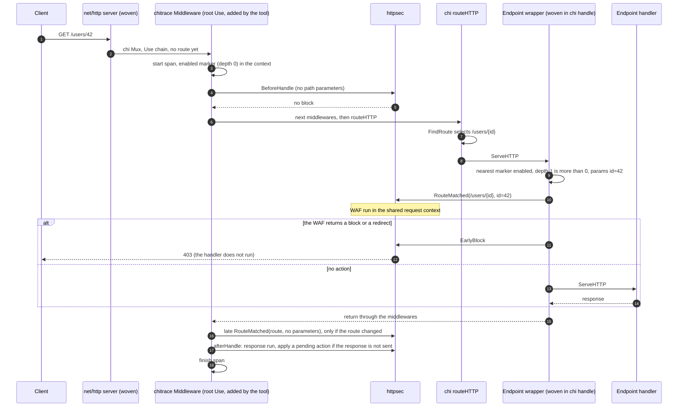

## Decided design v2 — Orchestrion/otelc endpoint hook + manual-`Use` docs (`chi.v5` and `chi`)

This proposal has **no open decision**: section 1 lists each decision and its reason.

**Scope:** both chi contribs (`contrib/go-chi/chi.v5` for chi v5.3.0, `contrib/go-chi/chi` for chi v1.5.5). Romain chose this: the woven builds (Orchestrion, otelc) get the path parameters through a hook, manual users get docs, and AppSec uses the standard `httpsec.RouteMatched` shared-context rules.

**Result for users**
- **Orchestrion or otelc users:** with no code change, the WAF gets the **matched** path parameters after routing and before the handler. A rule on a path parameter can block before the handler, and API Security can report `_dd.appsec.s.req.params`. There is still 1 chi span per request.
- **Manual users:** no behavior change. The godoc and 2 runnable `Example`s per package show where to add `Middleware` to get the path parameters.

### What changed since v1

| # | Change | Why |
|---|---|---|
| 1 | **Opt-outs:** when the hook is woven, a `Middleware` with `WithIgnoreRequest` (v5, v1) or `WithNoAppsec(true)` (v5) puts a **disabled marker** in the context. The wrapper obeys the nearest marker. | Blocking 1: an inner opt-out under the root `Use` did not stop the hook (B1–B3). |
| 2 | **chi v1:** `WithNoAppsec` is removed from all v1 text, ACs and recovery steps. | Blocking 1: v1 has no such option, and AC-A1 forbids a new API. |
| 3 | The marker is set in `Middleware`, at the existing `r.WithContext(ctx)` (v5 `chi.go:79`, v1 `chi.go:72`). It costs 1 allocation (a small context type that holds the marker by value). | Change 1 needs the marker where the options are read. This also removes the extra `r.WithContext` of v1. |
| 4 | The placement table is split ("without" / "with Orchestrion or otelc"). The 404/405 counts are corrected. The godoc says "Orchestrion or otelc". | Blocking 2. |
| 5 | **`*` rule changed:** `Wrap(h, includeWildcard)` keeps `*` only for method-specific routes whose registered pattern ends in `*`. It drops inherited `*` values and those for `mALL` routes (`Handle`, `HandleFunc`, `Mount`). | Non-blocking 1: `r.Get("/files/*", h)` now gives the same result as manual `r.With`. |
| 6 | `SetWovenForTest(bool) (restore func())`. The not-woven benchmark runs with `-run '^$'`. AC-O2 mount stub check: `Route("/routed/{tenant}")`, rule on `tenant`, `GET /routed/attack`, on both chi versions. | Blocking 3. |
| 7 | New edge-case rows and ACs: inner opt-outs (B1–B3), catch-all `*`, repeated names, wrapped non-`chi.Routes` mounts (fires 2 times). AC-W7 runs on a real server and checks the exact body. | Blocking 2, non-blocking 2 and 3. |
| 8 | **Invariants:** `Wrap` uses only zero-value state, proved by an AST test. The contrib must keep its import of `internal/endpointhook`. | Non-blocking 4. |
| 9 | `rep` is made in `func(next)`, next to `subrouterCache`. The non-chi mount check is only in AC-O2. `RouteMatched` calls are counted through a test hook in `internal/endpointhook`. | Non-blocking 5. |

---

### 1. Decisions and reasons

| # | Decision | Reason |
|---|---|---|
| 1 | Join point: **`function-body` on `(*Mux).handle`**, guard `method&mSTUB == 0` | See 2.1: 1 wrap per route at registration; runs after the inline middlewares; skips mount stubs and chi sub-router mounts; only existing Orchestrion features. Round 1 confirmed it on chi v5.2.2–v5.5.0, v1.5.5 and v4.1.2+incompatible. |
| 2 | Hook code in a new **internal** package of each contrib (`internal/endpointhook`), reached from chi with **`//go:linkname`** and `links:` | No import cycle, and no new public API. Same as `contrib/net/http/orchestrion.server.yml:18-33` and `orchestrion.client.yml:58-59`. Round 1 confirmed it with `-checklinkname=1` (the linker checks only standard-library symbols). |
| 3 | **Gate:** when the hook is woven and AppSec is on, every chitrace `Middleware` puts a marker in the context. It is **enabled** when AppSec runs in that middleware, and **disabled** for `WithIgnoreRequest` (v5, v1) or `WithNoAppsec(true)` (v5). The wrapper uses the **nearest** marker. | The nearest chi tracer of the endpoint decides, so an explicit opt-out wins over an outer root `Use` (B1–B3). With no marker, the wrapper does nothing. This covers AppSec off, a net/http-only request and a direct `ServeHTTP`. It emits 0 telemetry warnings. |
| 4 | Markers only when the hook is woven (`Woven()`) and `instr.AppSecEnabled()` | Manual users pay nothing: 1 atomic load, 0 allocations. With AppSec off there is no marker, because no enabled marker can exist. |
| 5 | Parameters: **last value of a name wins**. AppSec gets `*` only for a catch-all route registered with a method, such as `Get("/files/*", h)`, and it gets the value of that route. `includeWildcard = method != mALL && len(pattern) > 0 && pattern[len(pattern)-1] == '*'`. | The handler reads the last value (`chi.URLParam` reads from the end: v5 `context.go:100-107`, v1 `:99-106`). Mount levels retain their `*` keys, so a method-specific endpoint with no catch-all must drop those keys. `Mount`, `Handle` and `HandleFunc` register `mALL`; their `*` can be a non-chi mount value. `mALL` is a variable (`chi.RegisterMethod` changes it), but the guard reads it in the same `handle` call. The length check protects an empty pattern before chi validates it. |
| 6 | **Depth rule:** the hook runs only when the endpoint is deeper (`len(rctx.RoutePatterns)`) than the depth where the nearest enabled tracer started | With `r.With` or a leaf `Group.Use`, the tracer gave the parameters at its start, so the hook skips. There is no second WAF run, and the span count is unchanged. Round 1 measured the depths. |
| 7 | A hook block is applied with **`httpsec.EarlyBlock`**, and the handler is not called | The block response is written before the middlewares after `Middleware` can write a 200. `afterHandle` does not apply it again: the handler is consumed (`httpsec/http.go:322-323`), and `blockApplied` has precedence (`waf/metrics.go:255`). gin uses the same mechanism. |
| 8 | The hook reports the route through the tracer's route function (`rep`) | The hook route, the late route and the span `http.route` are the same (round 1 checked this). |
| 9 | **otelc parity in the same PR** | The `_integration` suite runs with Orchestrion and with otelc (`harness.go:70-71`; chi is in `.github/workflows/otelc.yml:60-63,102`). `inject_code` on an unexported method exists already (`ddtrace/tracer/otelc.yaml:155-161`). |
| 10 | No new switch or env var | gin, echo, gorilla and fiber give path parameters in woven builds with no switch. False blocks use the standard AppSec tools. |
| 11 | No system-tests change | There is no woven chi weblog. The `chi` weblog is manual, so it does not change. `_integration` tests the woven code. |
| 12 | Docs: `Middleware` godoc, `withAppsec` comment, 2 runnable `Example`s per package. **No `internal/appsec/README.md` change.** | Romain's rule: chi docs stay next to the chi code. |
| 13 | Keep draft PR #5961 and its branch. New title: `feat(contrib/go-chi): give AppSec the chi path parameters under Orchestrion and otelc` | A branch rename closed #5925. The branch name is not visible after a squash merge. |
| 14 | `Wrap` uses only zero-value package state (the `woven` `atomic.Bool`). | A package can register routes in `init()` or in a package-level `var` before `internal/endpointhook` is initialized (same issue: `contrib/valyala/fasthttp/otelc/hooks.go:71-73`). |
| 15 | Test-only setters in `internal/endpointhook`: `SetWovenForTest` and `SetRouteMatchedForTest` | `Woven()` does not go back to false by itself, and `httpsec` has no test hook. Internal, so not public API. |

**Accepted shared-context semantics (Romain's decision).** The hook uses `httpsec.RouteMatched`, as `r.With(Middleware())`, the dd `ServeMux`, fiber, gin, echo, gorilla and 5 of 6 other tracers do. For woven chi requests:
- the path rules use the shared request budget (`DD_APPSEC_WAF_TIMEOUT`, 2 ms by default);
- the path events count toward the 10-event cap;
- the native WAF does not report a second monitor rule of the same type;
- the action slot is latest-wins (`httpsec/http.go:131-133`). **This waives the "never replace a pending action" requirement for this hook.**
- condition matches stay between runs;
- there are **no prediction false blocks**: the parameters are read after chi selected the endpoint.

---

### 2. Mechanism

#### 2.1 Join point comparison (decision 1)

| Criterion | `method-call` on `(*node).FindRoute` | `function-body` on `(*node).FindRoute` + `mSTUB` guard | **`function-body` on `(*Mux).handle` (chosen)** |
|---|---|---|---|
| Orchestrion support | checked only on v1.14.0; no dd-trace-go aspect uses it | used by net/http, gorilla | `function-body` + `inject-declarations`/`links` (net/http) |
| otelc equivalent | none (a call with a receiver is otelc gap 1) | changing results with `inject_code`: not documented | `inject_code` + `add_file` with linkname (documented) |
| Allocations per request | 1 wrapper per `FindRoute` call | same | **0** (1 wrapper per route, at registration) |
| `r.With` / leaf `Group.Use` | runs before the inline `Middleware` (1 span instead of 2 on a block; 2 WAF runs on allow) | same | runs after it (inside `Chain(...)`, v5 `mux.go:416-435`); decision 6 skips |
| Mount stubs / chi sub-router mounts | extra guards | `endpoints[mSTUB]`, `subroutes == nil` | `mSTUB` set (v5 `mux.go:325-335`, v1 `:315-325`) |
| `*` of a non-chi mount | rest of path | same | decision 5 |
| chi v5 / v1 / v4 | pass | pass (b2) | pass (round 1 checked the same `handle` and `Mount` code) |

#### 2.2 Orchestrion aspect (new, in both `orchestrion.yml`)
This is chi v5. chi v1 uses receiver `*github.com/go-chi/chi.Mux` and the `chi/v2` contrib path.

```yaml
  - id: Mux.handle
    join-point:
      function-body:
        function:
          - receiver: '*github.com/go-chi/chi/v5.Mux'
          - name: handle
    advice:
      - inject-declarations:
          # go:linkname: the contrib imports chi, so chi cannot import the contrib.
          links:
            - github.com/DataDog/dd-trace-go/contrib/go-chi/chi.v5/v2/internal/endpointhook
          template: |-
            //go:linkname __dd_chitrace_wrapEndpoint github.com/DataDog/dd-trace-go/contrib/go-chi/chi.v5/v2/internal/endpointhook.Wrap
            func __dd_chitrace_wrapEndpoint(http.Handler, bool) http.Handler
      - prepend-statements:
          template: |-
            {{- $method := .Function.Argument 0 -}}
            {{- $pattern := .Function.Argument 1 -}}
            {{- $handler := .Function.Argument 2 -}}
            // Endpoints only: mount stubs and chi sub-router mounts have mSTUB.
            // Keep "*" only for method-specific catch-all endpoints (decision 5).
            if {{ $method }}&mSTUB == 0 {
              {{ $handler }} = __dd_chitrace_wrapEndpoint({{ $handler }}, {{ $method }} != mALL && len({{ $pattern }}) > 0 && {{ $pattern }}[len({{ $pattern }})-1] == '*')
            }
```
- The parameters are read through template variables. The only literal names are `mSTUB` and `mALL`, which exist in every chi version that round 1 checked.
- If the declaration needs explicit imports (`net/http`, `unsafe`), the advice lists them in `imports:`. AC-O1 proves that the woven chi package builds.
- The existing `NewMux` aspect does not change.

#### 2.3 otelc rules (new, in both `otelc/otelc.yaml`)
- `add_file`: a `//go:build ignore` file in the otelc rules module, with the same linkname declaration (`pattern-mapping.md:17,98`).
- `inject_code` on `where: {func: handle, recv: "*Mux"}`: set `{{- $method := .FuncArgument 0 -}}`, `{{- $pattern := .FuncArgument 1 -}}`, and `{{- $handler := .FuncArgument 2 -}}`. Use the same `mSTUB` guard and pass `{{ $method }} != mALL && len({{ $pattern }}) > 0 && {{ $pattern }}[len({{ $pattern }})-1] == '*'` as `includeWildcard`.
- **Link condition:** otelc blank-imports the rules module, and the rules module imports the contrib (`otelc/otelc.go`). So the contrib package must keep its import of `internal/endpointhook`. `Middleware` uses it, so the import is required by the code. The `endpointhook` package doc states this invariant.
- No rule in the repo uses `add_file` with a linkname on a third-party library yet. The otelc runs of AC-O1–O5 are required.

#### 2.4 Hook package `internal/endpointhook` (new, in each contrib)
- **Files:** `wrap_appsec.go` (`Wrap`, the wrapper type, `woven`) and `marker_appsec.go` (the marker, the context type, the test setters). The `*appsec.go` names make `@DataDog/asm-go` the owners (`CODEOWNERS:71`).
- **Imports:** chi, `httpsec` and `dyngo`. chi does not import this package, so there is no cycle.

```go
type Marker struct {
	Disabled bool     // WithIgnoreRequest (v5, v1) or WithNoAppsec(true) (v5)
	Depth    int      // len(rctx.RoutePatterns) when the tracer started
	Route    Reporter // the tracer's route function (decision 8)
}
type Reporter interface{ ReportedRoute(*chi.Context) string }

func With(ctx context.Context, m Marker) context.Context // 1 allocation; the nearest marker wins
func Woven() bool                                        // true after the first Wrap call
func Wrap(h http.Handler, includeWildcard bool) http.Handler // linkname target; Wrap(nil, _) returns nil

// Test only (internal, so not public API). Used with t.Cleanup / b.Cleanup.
func SetWovenForTest(woven bool) (restore func())
func SetRouteMatchedForTest(fn func(context.Context, string, map[string]string) error) (restore func())
```

**`Wrap` invariant (decision 14):** `wrap_appsec.go` has no `func init` and no package-level `var` with a value. `Wrap` only stores `true` in `woven` (an `atomic.Bool`) and returns a value of an unexported struct type. The `RouteMatched` test hook is in `marker_appsec.go`. The wrapper reads it only at request time, after all packages are initialized.

**Wrapper steps at request time:**
1. Look up the nearest `Marker` in `r.Context()`. If there is none, or if it is `Disabled`, call `h` and stop.
2. Read `rctx := chi.RouteContext(r.Context())`. If `rctx == nil` or `len(rctx.RoutePatterns) <= m.Depth`, call `h` and stop.
3. Build the parameters from `rctx.URLParams`. The last value of a name wins. `*` is included only if `includeWildcard` is true. If the set is empty, call `h` and stop: no WAF run.
4. Call `RouteMatched(r.Context(), m.Route.ReportedRoute(rctx), params)`. This is `httpsec.RouteMatched`, or the test hook.
5. On an error: emit `httpsec.EarlyBlock{}` on the nearest `httpsec.HandlerOperation`, and return without calling `h`. With no error: call `h`.

The wrapper type has `Unwrap() http.Handler`.

#### 2.5 Changes in `Middleware` (`*/chi.go`) and `withAppsec` (`*/appsec.go`)
Read `instr.AppSecEnabled()` once per request into a local variable before the ignore check. Use that same value for the marker gate and the `withAppsec` decision. Markers are set only when `endpointhook.Woven()` and that local value are both true.

**chi v5 (`chi.go`):**
- In `func(next)`, next to `subrouterCache` (`:60`), make `rep`. It is a struct with `cfg` and `&subrouterCache`, and it calls `reportedRoute`. So 2 routers that use 1 `Middleware()` value do not share a cache.
- `WithIgnoreRequest` branch (`:62-65`): `r = r.WithContext(endpointhook.With(r.Context(), endpointhook.Marker{Disabled: true}))` before `next.ServeHTTP`.
- Before `r = r.WithContext(ctx)` (`:79`), add to `ctx`:
  - `Marker{Disabled: true}` when `cfg.appsecDisabled`;
  - else, when `rctx != nil`: `Marker{Depth: len(rctx.RoutePatterns), Route: rep}`.

**chi v1 (`chi.go`):**
- Same at `:55-58` (`WithIgnoreRequest`) and `:72` (`r.WithContext`), with no `WithNoAppsec` case.
- `rep` is a zero-size package value that returns `rc.RoutePattern()`.

**`withAppsec`:** the code does not change, only its comment (section 4). The late `RouteMatched(finalRoute, nil)` (v5 `appsec.go:60-72`, v1 `:58-70`) still runs after a hook block, because the hook returns through the router. It sets the final route with no WAF run.

---

### 3. Edge cases (both chi versions unless stated)

| Case | Behavior |
|---|---|
| Root `Use` (woven default), `GET /users/{id}` | Fires 1 time: `{id}`. A block gives 403 before the handler. 1 chi span. |
| `Route("/routed/{tenant}", …)` endpoint | Fires 1 time: `{tenant, id}`. 1 span (chi's internal `NewRouter` is not woven by `NewMux`). |
| `Mount` of a user `chi.Routes` sub-router (Orchestrion adds its `Use`) | The inner tracer starts at depth 1. The hook fires at the endpoint (depth 2), on the inner operation, 1 time. 2 spans, as today. |
| Mount stub: `Route("/routed/{tenant}")` with no `/` child, `GET /routed/attack` | Not wrapped (`mSTUB`): 404, no path event (round 1: E1). |
| `Mount` of a wrapped non-`chi.Routes` handler (`http.HandlerFunc(api.ServeHTTP)`, `otelhttp.NewHandler(api, …)`, `http.StripPrefix`), or `Handle("/sub/*", sub)` | The outer `/*` is `mALL` with no `mSTUB`, so it is wrapped. It fires with the mount parameters (no `*`), if there are some. Then the inner chi endpoint fires with all of them: **2 path-parameter WAF runs**, with the same values. |
| Non-chi mount (`r.Mount("/files", http.FileServer(…))`) | Wrapped (`mALL`). No `*` sent, so a rule on `*` does not block. |
| Catch-all `r.Get("/files/*", h)` | `*` sent (method-specific). Same result as manual `r.With` (round 1: D1/D2 now agree). |
| Catch-all `r.Handle("/files/*", h)` | `*` not sent (`mALL`). |
| Repeated name: `Route("/m/{id}")` + `Get("/items/{id}")` | `id` = the endpoint value (last wins). Manual `r.With` gives the first value on v5 and the last on v1, unchanged. |
| Inner `r.With(Middleware(WithNoAppsec(true)))` under the woven root (v5) | Disabled marker, so the hook stops: no path parameters. The root still runs its request rules. 2 spans. |
| Inner `WithIgnoreRequest` that ignores the request (v5, v1), on `r.With` or a sub-router `Use` | Disabled marker, so the hook stops. The inner middleware starts no span. |
| `r.With(Middleware())` or leaf `Group.Use` under the woven root | Decision 6: the hook skips. The parameters reach the WAF 1 time (inner `BeforeHandle`). 2 spans. |
| `Group.Use` around `Route`/`Mount` | That tracer starts at the mount depth, so the hook fires at the endpoint. |
| Enclosing integration with parameters (dd `ServeMux`) | Standard semantics: chi's set replaces the address value. Matched conditions stay. Same as `r.With` today. |
| Block when the response already started (flush through a visible tracker) | `EarlyBlock` reports `block_failure`. The handler does not run (`httpsec/http.go:312-320`). |
| Middlewares between the tracer and the endpoint, on an early block | They see no status and no bytes on their own writers (round 1: C1). On a real server, the block `Content-Length` (`waf/actions/block.go:233`) stops their extra bytes. |
| 404 / 405 | No endpoint handler, so no hook. |
| `chi.Walk`, `docgen` under a woven build | They see the wrapper. `Unwrap()` gives the original handler. |

---

### 4. Docs and `Example`s (both packages)

**`Middleware` godoc** (v5 `chi.go:34-45`, v1 `chi.go:31-42`). Keep the first AppSec paragraph (writers and `Unwrap`). Replace the second paragraph with this (v5 text; the v1 differences are in the last 2 bullets of this section):

```go
// With Orchestrion or otelc, no code change is necessary. They add Middleware to
// the routers that chi.NewRouter and chi.NewMux return, and they wrap the endpoint
// handlers of chi. After chi selected the endpoint, the wrapper gives AppSec the
// route and the path parameters, before the handler: a rule on a path parameter can
// then block the request before the handler. For a name used at 2 levels, AppSec
// gets the value of the endpoint. AppSec gets "*" only for a catch-all route
// registered with a method, such as Get("/files/*", h), and it gets the value of
// that route. The nearest Middleware decides whether the wrapper runs: one with
// WithNoAppsec(true), or one that ignores the request with WithIgnoreRequest,
// turns the wrapper off.
//
// Without Orchestrion or otelc, chi runs a Middleware added with Use before routing:
// AppSec gets no path parameters, and it gets the route after the handler. To give
// AppSec the path parameters before the handler, add Middleware where chi already
// selected the endpoint: on the endpoint (r.With(Middleware()).Get(...)), or with Use
// in the Group that registers the endpoint. AppSec then also gets "*", and for a name
// used at 2 levels, the first value. A Group around Route or Mount does not get the
// path parameters of the child router. If you also keep a Middleware at the root,
// AppSec also covers the requests that match no endpoint (404, 405) and the
// middlewares before routing, and each matched request gets 1 more span. Both
// middlewares use the same AppSec request context.
```
- v1: replace "one with WithNoAppsec(true), or one that ignores the request with WithIgnoreRequest" with "one that ignores the request with WithIgnoreRequest".
- v1: replace "the first value" with "the last value".

**`withAppsec` comment** (`*/appsec.go`). Keep the current text, and add after its first paragraph (v5 text; v1 removes the `WithNoAppsec` parts and writes "last value" in table A):

```go
// With Orchestrion or otelc, chi's (*Mux).handle wraps each endpoint handler with
// internal/endpointhook.Wrap. Middleware then puts an endpointhook.Marker in the
// request context. A disabled marker means WithIgnoreRequest or WithNoAppsec(true).
// Otherwise the marker has the routing depth at which Middleware started, and the
// route function. The wrapper reads the nearest marker. When the marker is enabled and
// chi selected an endpoint deeper than that depth, the wrapper gives the WAF the path
// parameters of the endpoint with httpsec.RouteMatched, before the handler: the last
// value of a name. AppSec gets "*" only for a catch-all route registered with a method,
// such as Get("/files/*", h), and it gets the value of that route. It applies a block
// with httpsec.EarlyBlock: the middlewares between Middleware and the
// endpoint see no status and no bytes on their own response writers. The wrapper does
// nothing when there is no marker (AppSec off, no chitrace Middleware), when the marker
// is disabled, or when Middleware started at the endpoint (r.With, or Use in the
// Group that registers the endpoint).
//
// A. Without Orchestrion or otelc
//
//	Placement                         Path parameters before the handler          Spans: match / 404, 405
//	Use at the root                   none                                        1 / 1
//	r.With, or Use in the leaf Group  all, "*" included; repeated name: first     1 / 0
//	Use at the root + r.With          as r.With (inner middleware)                2 / 1
//	Group.Use around Route or Mount   mount parameters and "*" (rest of path)      1 / 1 under the mount, else 0
//
// B. With Orchestrion or otelc (they add the Use at the root)
//
//	Placement in user code            Path parameters before the handler          Spans: match / 404, 405
//	none                              wrapper: last value; "*" for method-specific catch-all only  1 / 1
//	r.With, or Use in the leaf Group  as A (inner middleware); wrapper skips      2 / 1
//	Group.Use around Route or Mount   wrapper fires at endpoint                   2 / 2 under the mount, else 1
//	r.With(Middleware(WithNoAppsec))  none (disabled marker)                      2 / 1
//	WithIgnoreRequest that ignores    none (disabled marker)                      1 / 1
//	user sub-router (NewRouter+Mount) wrapper, on the inner operation             2 / 2 under the mount, else 1
//	Mount of a wrapped non-chi.Routes wrapper, 2 times (mount, endpoint)          as its routers
```

**`Example`s** (`*/example_test.go`, with `// Output:`, so `go test` runs them; AppSec and the tracer are off; requests through `httptest.NewRecorder`):
- `Example_orchestrion`: `chi.NewRouter()` and `Get("/users/{id}", …)` with no dd-trace-go call. The comment says what Orchestrion or otelc adds. Output: `user 42`.
- `Example_pathParameters`: root `Use(chitrace.Middleware())`, `With(chitrace.Middleware()).Get("/users/{id}", …)`, and `Group(func(g chi.Router) { g.Use(chitrace.Middleware()); g.Get("/orders/{id}", …) })`. The comments give the span and coverage trade-off. Output: `user 42`, `order 7`.

---

### 5. Constraints

- **Compatibility:**
  - chi v5 ≥ v5.3.0 and chi v1.5.5. The v1 aspect also weaves v4.1.2+incompatible (same import path), and round 1 compiled it.
  - Orchestrion ≥ `.orchestrion-version` (v1.14.0). otelc at `OTELC_VERSION`.
  - Manual users: no behavior change.
- **Rollout:** the next minor release. Release note: "contrib/go-chi: with Orchestrion or otelc, AppSec now gets the chi path parameters before the handler. Rules on path parameters can block before the handler, and API Security reports `req.params`." No flag (decision 10).
- **Recovery:**
  - False blocks: AppSec exclusion filters or rule changes through Remote Config. No release is needed.
  - A defect in the hook, for 1 part of an app: add an inner `Middleware` that opts out on that part (v5: `r.With(chitrace.Middleware(chitrace.WithNoAppsec(true)))`; v5 and v1: `WithIgnoreRequest`).
  - For the whole app: pin the previous dd-trace-go version, or turn AppSec off.
  - A revert of the PR leaves no stored state.
- **Allocations and benchmarks** (`BenchmarkMiddlewareAppSec`, new sub-benchmarks; weaving simulated with `endpointhook.Wrap`):
  - not woven: run with `-run '^$'` and `SetWovenForTest(false)`; equal to `main` (benchstat, no significant change);
  - woven, AppSec off: 0 more allocations per request; ns/op at most +2%;
  - woven, `WithNoAppsec(true)` (v5) or an ignored request: at most 1 more allocation (2 for an ignored request);
  - woven, AppSec on, root `Use`, `/users/{id}`: allocations and ns/op at most those of the manual stacked setup on `main` (root `Use` + `r.With`), which gives the WAF the same data.

---

### 6. Sequence: woven build, root `Use`



---

### 7. Acceptance criteria (both packages unless stated)

**[unit test]** (`internal/endpointhook`, no WAF; `RouteMatched` calls are counted with `SetRouteMatchedForTest`)
- [ ] AC-U1 Gate: no marker → `h` runs 1 time, 0 `RouteMatched` calls. A nearest disabled marker under an outer enabled marker → the same.
- [ ] AC-U2 Parameters: last value wins. `includeWildcard=false` drops every `*`. `includeWildcard=true` keeps the last `*` value. An empty set gives 0 calls.
- [ ] AC-U3 Depth: equal depth skips, a deeper endpoint fires. `Wrap(nil, _)` returns `nil`. `Woven()` is true after `Wrap`. `SetWovenForTest` restores the old value.
- [ ] AC-U4 `TestWrapZeroValueState`: an AST check of `wrap_appsec.go` fails on a `func init`, on a package-level `var` with a value, or if `Wrap` calls anything declared outside `wrap_appsec.go`.

**[integration test, real WAF]** (contrib tests on `httptest.Server`. Endpoints are wrapped with `endpointhook.Wrap(h, includeWildcard)`, using the method and pattern rule in decision 5, to simulate weaving. Call `SetWovenForTest(true)` before the first `Wrap`, with `t.Cleanup`.)
- [ ] AC-W1 Root `Use`, rule on `id`: 403, handler not run, 1 event, 1 chi span.
- [ ] AC-W2 `Route` and user `chi.Routes` `Mount`: 1 call with `{tenant, id}`. Spans: 1 and 2. For `Route("/routed/{tenant}")` + `Get("/items/{id}")`, `_dd.appsec.s.req.params` has no `*` key.
- [ ] AC-W3 Catch-all, rule on `*`: `r.Get("/files/*")` → 403, the same result as manual `r.With` (D1/D2). `r.Handle("/files/*")` → 200, no event. `Route("/routed/{tenant}")` + `Get("/files/*")` sends `{tenant, *}` with that endpoint's catch-all value, and `_dd.appsec.s.req.params` contains those two keys.
- [ ] AC-W4 Repeated name, `Route("/m/{id}")` + `Get("/items/{id}")`, rule `id=attack`: `GET /m/attack/items/42` → 200 (the hook sends `id=42`). `GET /m/42/items/attack` → 403. The manual `r.With` results stay as in `main` (v5: 403 for the first request; v1: 200).
- [ ] AC-W5 `r.With` and leaf `Group.Use` under root `Use`: 403 as in `main`, 2 spans, 0 hook `RouteMatched` calls.
- [ ] AC-W6 Opt-outs. For each applicable router, send two requests: `GET /users/attack` gives 200 and no path event; `GET /users/42` with a blocked header gives 403 through the root. AppSec-off and no-chitrace cases test the path gate separately.
  - B1 (v5): root `Use` + `r.With(Middleware(WithNoAppsec(true)))`.
  - B2 (v5, v1): root `Use` + `r.With(Middleware(WithIgnoreRequest(…)))` that ignores the request.
  - B3: a mounted sub-router with `Use(Middleware(WithNoAppsec(true)))` (v5), or with `WithIgnoreRequest` (v5, v1).
  - Also: AppSec off; an outer `httpsec.WrapHandler` with no chitrace.
- [ ] AC-W7 Early block on a real server: a middleware between root `Use` and the endpoint writes `default-body` after `next` when its own writer saw nothing. Result: status 403, body exactly the block JSON, the block applied 1 time, `block_failure:false`.
- [ ] AC-W8 After a hook block, the span `http.route` and the operation route are `/users/{id}`.
- [ ] AC-W9 Wrapped non-`chi.Routes` mount: `r.Handle("/t/{tenant}/*", Wrap(sub, false))`, with a wrapped endpoint in `sub` → 2 calls (`{tenant}`, then `{tenant, id}`). `sub` registers the full path (`/t/{tenant}/items/{id}`), because `Handle` does not shift the routing path as `Mount` does.
- [ ] AC-W10 Standard semantics, pinned (a later core change shows here):
  - pending body block + path/response redirect → 303;
  - 5,000 path rules → 200 and `waf_timeout:true`;
  - 9 query events + 1 path event → the header event is dropped.
- [ ] AC-W11 All existing chi tests pass with **no** changed expectation. Each new test that weaves calls `SetWovenForTest` before its first `Wrap`, and restores the old value with `t.Cleanup`.

**[Orchestrion integration test]** (`internal/orchestrion/_integration/chi.v5/appsec.go` and `chi/appsec.go`, `TestCaseAppSec` as in `fiber.v2/appsec.go`, rules in `testdata/chi-path-params.json`, `generated_test.go` regenerated. Each runs with **Orchestrion and with otelc**.)
- [ ] AC-O1 Woven root, `/users/attack`: 403, handler 0 times, 1 chi span. `/users/42`: 200.
- [ ] AC-O2 Mounts:
  - `Route` and user `Mount` endpoints block.
  - **Mount stub:** `Route("/routed/{tenant}", …)` with no `/` child, a block rule on `tenant`, `GET /routed/attack` → 404 and no path event. A wrapped stub would give 403.
  - Non-chi mount `r.Mount("/files", http.HandlerFunc(...))` with a handler that returns 200, rule on `*` → 200, no event.
  - `r.Mount("/w/{tenant}", http.HandlerFunc(api.ServeHTTP))`: a block on `tenant` and a block on `id` both give 403.
- [ ] AC-O3 Opt-outs under the woven root:
  - v5: `r.With(chitrace.Middleware(chitrace.WithNoAppsec(true))).Get("/opt/{id}", …)`: on the same router, `/opt/attack` → 200, no path event; `/opt/42` with a blocked header → 403.
  - v5, v1: the same two requests with `WithIgnoreRequest`.
  - A router under `//orchestrion:ignore` and `//otelc:ignore` with no chi middleware, served by `http.Server` → 200, no path event. Put this case in its own `_integration` package with no other `chitrace` import.
- [ ] AC-O4 `r.With(chitrace.Middleware())` under the woven root → 403, 2 chi spans.
- [ ] AC-O5 The woven chi package builds and links on both chi versions, with the linkname target found through `links:` (Orchestrion) and through the rules-module import (otelc). The isolated ignored-router package in AC-O3 has no other `chitrace` import, so an incorrect `links:` path fails to link.

**[telemetry]** (`testutils.StartTelemetryRecorder`)
- [ ] AC-T1 0 occurrences of "RouteMatched called without an active HandlerOperation" in AC-W6 and AC-O3.
- [ ] AC-T2 A hook block gives 1 `waf.requests` point with `request_blocked:true` and `block_failure:false`. With a fresh sampling key (`DD_API_SECURITY_SAMPLE_DELAY`, as `setups_appsec_test.go:352`), the schema has `_dd.appsec.s.req.params`. No new metric name.

**[benchmark]**
- [ ] AC-B1 The 4 targets of section 5, `-count 10`, benchstat table in the PR description. The not-woven run uses `-run '^$'`.

**[system-tests]**
- [ ] AC-S1 The `chi` weblog jobs pass with no manifest change.

**[apidiff]**
- [ ] AC-A1 No exported API change in `contrib/go-chi/chi.v5`, `contrib/go-chi/chi` and the root module. chi v1 gets no `WithNoAppsec`. `internal/endpointhook` is not public.

**[docs]**
- [ ] AC-D1 The 4 `Example`s pass. `internal/appsec/README.md` does not change. The godoc and the comment have the text of section 4.

---

### 8. Review requirements
1. The Adversarial Reviewer challenged v2. The squad Reviewer reviews the PR after implementation.
2. **`@DataDog/apm-orchestrion`** (`CODEOWNERS:146-149`): the `Mux.handle` aspect, the linkname with `links:`, and the `_integration` tests.
3. **`@DataDog/asm-go`** (`CODEOWNERS:67-72`): `internal/endpointhook/*_appsec.go`, the marker rules in `Middleware`, the `withAppsec` comment, the `EarlyBlock` use, and the stated shared-context semantics.
4. **`@DataDog/apm-go` / `@DataDog/apm-idm-go`** (`CODEOWNERS:60`): the contribs, the otelc rules, the godoc and the `Example`s.

**Effort:** about 20 h (v1: 18 h). The +2 h is for the disabled markers, the new ACs and the AST test.
- hook package + markers: 4 h
- aspects: 1.5 h
- otelc rules: 2 h
- contrib tests: 5 h
- `_integration` tests: 3 h
- docs + `Example`s: 1.5 h
- benchmarks: 1 h
- review fixes: 2 h

**Out of scope:** core `httpsec` changes, a route prediction for manual `Use`, a `WithNoAppsec` option for chi v1, and a woven chi weblog in system-tests.

