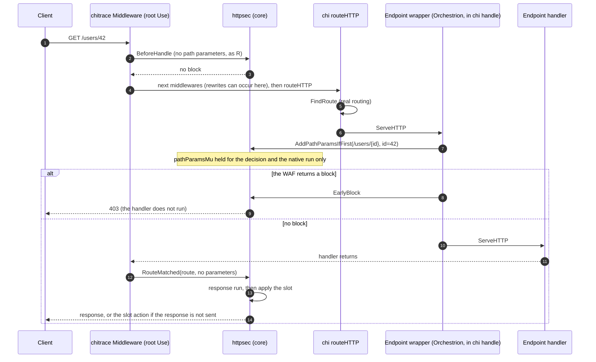

# Design: how AppSec gets chi path parameters (`Use` before routing)

> **Status: for design review only. This file has no code change. It can be
> removed before merge.** The delivered change of this PR is documentation
> (godoc, `internal/appsec/README.md`) and 2 compiled `Example` functions per
> package (section 2). The document has **no open decision**: the 3 decisions
> are made in section 1.
> Origin: ROMAIN-51 (follow-up of DD-20 / PR #5847).

Code references are at dd-trace-go `main` `b3dc60f72`, chi `v5.3.0` and
`v1.5.5`, go-libddwaf `v5.1.0`.

## 1. Decisions

### Decision 1: R + docs (no runtime change)

**What it is:** chi keeps the current AppSec behavior. The docs explain how to
give the path parameters to the WAF: put `Middleware()` on the endpoint
(`r.With(Middleware())`), or use `g.Use(Middleware())` on the `Group` that
registers the endpoint itself.

**Reasons:**
- The other tracers (5 of 6) give the WAF the parameters **after** routing,
  before the handler. With `Use` before routing, chi has no hook at that point.
  The only option that needs no user code and no Orchestrion is a route
  **prediction** (M1). The Adversarial Reviewer proved on chi v5.3.0 and v1.5.5
  that a prediction can be wrong: a rewrite, a mount, or a middleware that
  answers itself. A wrong prediction can block a valid request, and no fix is
  possible.
- Every option that adds the parameters to the shared WAF context loses some
  protections of the current behavior:
  - a later action can replace a pending block;
  - the path rules use the shared 2 ms budget, so a later block can be lost;
  - the 10-event cap can drop a later report;
  - a rule can combine values from 2 routers.

  The fix is a change of the core action rules for **all** integrations, which
  `@DataDog/asm-go` owns. That is larger than a chi issue.
- `r.With` and the leaf `Group.Use` already give the matched parameters today.
  They were checked on both chi versions.
- Cost: about 2 h, and no runtime risk.

### Decision 2: no option P now, and no follow-up issue now

**Reason:** P needs a core change of the action rules first. That is a separate
initiative for the AppSec owners. Appendix A ("Why not P now") keeps the P
analysis. It lists the 3 blockers, so that a later issue can start from it.

The decisions D2–D6 of the earlier draft were only for P, so they are no longer
decisions. They are "conditions for a later P" in Appendix A (A.8). The 2
non-blocking reviewer notes (the mount-alias test, and the route checks per
mechanism) are also only for P: they are in A.7.

### Decision 3: add a compiled `Example` for each placement

**Reason:** `go test` compiles the examples, so the docs cannot become incorrect
without a test failure.

---

## 2. The delivered change

Files that the delivered change touches. Nothing else changes: no runtime code,
no public API, no test expectation.

| File | Change |
|---|---|
| `contrib/go-chi/chi.v5/chi.go` | New `Middleware` godoc (2.1) |
| `contrib/go-chi/chi/chi.go` | New `Middleware` godoc (2.1) |
| `internal/appsec/README.md` | Section "Late blocks and route reports in HTTP contribs" (2.2) |
| `contrib/go-chi/chi.v5/example_test.go` | 2 new `Example` functions and 2 helpers (2.3) |
| `contrib/go-chi/chi/example_test.go` | The same, for chi v1 (2.3) |

### 2.1 New text of the `Middleware` godoc

Same text in `contrib/go-chi/chi.v5/chi.go` (replaces the lines 34–45) and in
`contrib/go-chi/chi/chi.go` (replaces the lines 31–42). The function signature
does not change. In chi v1, the import is `github.com/go-chi/chi` and the
package name in the code is `chi`.

```go
// Middleware returns middleware that will trace incoming requests.
//
// # AppSec
//
// Add Middleware before any middleware that writes or flushes the response, and
// make the response writers of the middlewares after it implement Unwrap(): AppSec
// must see the response to decide if a block can still replace it.
//
// # AppSec and path parameters
//
// AppSec gets the route and the path parameters before the handler only when
// chi has already selected the endpoint at the moment Middleware starts.
//
// With Use at the root of the router, chi selects the endpoint after Middleware
// starts. AppSec then gets the route after the handler returns, and no path
// parameters: rules on path parameters and the API Security schema of the path
// parameters (_dd.appsec.s.req.params) do not apply.
//
// To give the path parameters to AppSec before the handler, put Middleware on
// the mux that registers the endpoint itself. Use r.With on the endpoint:
//
//	r.With(chitrace.Middleware()).Get("/users/{id}", handler)
//
// Or use Use in a Group, and register the endpoint directly on that Group:
//
//	r.Group(func(g chi.Router) {
//		g.Use(chitrace.Middleware())
//		g.Get("/users/{id}", handler)
//	})
//
// A Group middleware around Route or Mount does not get the path parameters of
// the child router. The child router does its own routing, after the Group
// middleware ran.
//
// Middleware at the root and Middleware on the endpoint can be used together.
// The root one keeps the spans and the AppSec coverage of requests that no
// endpoint matches (404, 405) and of the work that runs before routing. The
// cost is 1 more span for each matched request. 2 spans do not mean 2
// WAF contexts. If Middleware is
// only on the endpoint, requests that no endpoint matches are not traced.
```

### 2.2 New text of `internal/appsec/README.md`

Section "Late blocks and route reports in HTTP contribs" (line 369). Paragraphs
1 and 2 do not change. A new paragraph and a new table go **between** paragraph
2 and the last paragraph ("go-chi details are next to the code ..."). The last
paragraph does not change.

New text:

```markdown
#### go-chi: where Middleware runs, and the path parameters

AppSec gets the path parameters of go-chi only when chi has selected the
endpoint before `Middleware` starts. The table gives the result for each
placement. Results are the same on chi v5.3.0 and v1.5.5. The "spans" column is
the number of go-chi spans for a matched request.

| Placement | What `Middleware` sees at its start | Spans |
|---|---|---:|
| `Use` at the root only | No route and no path parameters. AppSec gets the route after the handler. | 1 |
| `r.With(Middleware())` on the endpoint, or `Group.Use` with the endpoint registered directly on that `Group` | The route (`/users/{id}`) and the path parameters (`id=42`). | 1 |
| `Use` at the root **and** one of the 2 placements above | The root sees no path parameters. The inner one sees `id=42`. | 2 (parent and child) |
| `Group.Use` around `Route("/docs", child)` or `Mount` | The mount pattern (`/docs/*`) and the rest of the path. **Not** the path parameters of the child. | 1 |
| `Group.Use` only, path or method that no endpoint matches | The `Group` middleware does not run (404 or 405). | 0 |

`Use` at the root keeps the coverage of requests that no endpoint matches and of
the work before routing. `Middleware` only on the endpoint loses it. Using both
keeps it, and adds 1 child span for each matched request. Orchestrion adds
`Use(Middleware())` at the root. 2 spans do not mean 2 WAF contexts.

A rule that needs the path parameters before the handler needs the endpoint
placement.
```

### 2.3 The `Example` functions

2 functions per package, in the existing `example_test.go` of each package
(`package chi_test`). The names are the same in both packages:

| Function | What it shows |
|---|---|
| `Example_withEndpoint` | `router.With(chitrace.Middleware()).Get("/users/{id}", userHandler)` |
| `Example_withGroup` | `router.Group(...)`: `g.Use(chitrace.Middleware())`, then `g.Get("/users/{id}", userHandler)` on the same `Group` |

Code (chi v5; for chi v1 the import paths are
`github.com/DataDog/dd-trace-go/contrib/go-chi/chi/v2` and
`github.com/go-chi/chi`; the code is the same). It needs 2 new imports:
`fmt` and `net/http/httptest`.

```go
func userHandler(w http.ResponseWriter, r *http.Request) {
	fmt.Fprintf(w, "user %s", chi.URLParam(r, "id"))
}

// serve sends 1 GET request to the router and prints the status and the body.
func serve(router http.Handler, path string) {
	rec := httptest.NewRecorder()
	router.ServeHTTP(rec, httptest.NewRequest(http.MethodGet, path, nil))
	fmt.Println(rec.Code, rec.Body.String())
}

// Example_withEndpoint puts the middleware on the endpoint. chi has selected
// the endpoint when the middleware starts, so AppSec gets the route and the
// path parameters before the handler.
func Example_withEndpoint() {
	router := chi.NewRouter()
	router.With(chitrace.Middleware()).Get("/users/{id}", userHandler)

	serve(router, "/users/42")
	// Output: 200 user 42
}

// Example_withGroup puts the middleware in a Group, and registers the endpoint
// on the same Group. The Group middleware runs after chi selects the endpoint.
func Example_withGroup() {
	router := chi.NewRouter()
	router.Group(func(g chi.Router) {
		g.Use(chitrace.Middleware())
		g.Get("/users/{id}", userHandler)
	})

	serve(router, "/users/42")
	// Output: 200 user 42
}
```

**Checked:** this code was compiled and run on a scratch copy of both packages at
`b3dc60f72`: `Example_withEndpoint` and `Example_withGroup` pass in
`contrib/go-chi/chi.v5` and in `contrib/go-chi/chi`.

**Limit:** the examples run with AppSec off and with no tracer started. They
prove that the documented code compiles and routes, and that the handler gets
the path parameter. They do not prove what AppSec receives. That behavior is
the table of 2.4, which the Adversarial Reviewer measured with the real
middleware and `mocktracer`.

### 2.4 Placement table (adversarial review, round 2)

The Adversarial Reviewer ran the real chi contrib middleware with `mocktracer`
on `b3dc60f72`, with chi v5.3.0 and v1.5.5. The results are the same on both
versions. AppSec was off for this span and dispatch check.

| Placement | What the middleware saw | Chi spans |
|---|---|---:|
| Root `Use` only | No pattern or `id` at entry | 1 |
| `With` on the endpoint, or `Group.Use` with `Get` registered directly on that group | `/users/{id}`, `id=42` | 1 |
| Root `Use` **plus** either endpoint placement | Root saw no params; inner middleware saw `id=42` | **2, parent and child** |
| `Group.Use` around `Route("/docs", child)` | `/docs/*` and the mount remainder, **not** the child's `id` | 1 |
| Group only, unmatched path / wrong method | Group middleware never ran (404 / 405) | 0 |

`Group` builds an inline mux with `With`. `Route` creates and mounts another mux
(chi v5 `mux.go:235-278`; v1 `mux.go:224-268`).

### 2.5 Trade-off: root `Use` against leaf instrumentation

- **Replace** root `Use` with leaf instrumentation: the leaf gets the matched
  parameters, but AppSec loses the coverage of **unmatched requests** (404, 405)
  and of **work before dispatch** (for example the middlewares before routing).
  The table shows 0 spans for an unmatched request with a group only.
- **Stack** root `Use` and leaf instrumentation: the root keeps that coverage.
  The cost is a child span on each matched request (2 spans).
- Orchestrion already adds `Use(Middleware())` at the root. With Orchestrion,
  adding leaf instrumentation is the "stack" case.
- **2 spans do not mean 2 WAF contexts.** The child middleware reuses the WAF
  context of the request when it finds one (`StartOperation`,
  `instrumentation/appsec/emitter/httpsec/http.go:115-146`).

---

## 3. Acceptance criteria (delivered change only)

Numbers AC9 and AC13 are the numbers of the earlier draft. The other criteria of
the earlier draft are for a later P: see A.9.

- [ ] **AC9** `[integration test, real WAF]` All chi tests at `b3dc60f72` pass
  with no changed expectation, in both packages. No test file other than
  `example_test.go` changes.
  `cd contrib/go-chi/chi.v5 && go test ./...`, and the same in
  `contrib/go-chi/chi`.
- [ ] **AC13** `[system-tests]` The `chi` weblog jobs of the dd-trace-go
  system-tests workflow (`.github/workflows/system-tests.yml`) pass with no
  manifest change in `DataDog/system-tests`.
- [ ] **AC15** `[unit test]` The `Example` functions compile and pass in both
  packages: `go test -run '^Example' -v .` in `contrib/go-chi/chi.v5` and in
  `contrib/go-chi/chi`. The output lists `Example_withEndpoint` and
  `Example_withGroup` as `PASS`.
- [ ] **AC16** `[CI, apidiff]` apidiff shows no change: no exported symbol is
  added, removed or changed. The `Middleware` signature is the same. The
  `Example` functions are in `_test.go` files, so they are not public API.

---

## 4. Review requirements for the delivered change

1. The Adversarial Reviewer challenge (2 rounds) is **done**. Its result is the
   placement table (2.4).
2. Code review with the `code-review` skill is not required for the delivered
   change when it only has godoc, README and `Example` code. The reviewer of the
   PR checks that the text of 2.1 and 2.2 is the text in the files.
3. Contrib owners (`@DataDog/apm-go`, `@DataDog/apm-idm-go`, `CODEOWNERS:60`)
   approve the change in `contrib/`.
4. `@DataDog/asm-go` (`CODEOWNERS:67-72`) approves the change in
   `internal/appsec/README.md`.

---

# Appendix A: Why not P now

This appendix keeps the analysis of option **P** ("R + a post-routing hook": the
path parameters go to the WAF after routing, before the handler, in the same WAF
context). The delivered change does not do P (Decision 2). Nothing in this
appendix is a decision. A later issue can start from it.

Terms: **R** = the current behavior (no path parameters with `Use` before
routing). **D** = an independent WAF context for the path parameters (it is not
a subcontext: it does not inherit the state of the request context, so it loses
the shared response-rule and schema behavior). **M1–M6** = the mechanisms in A.2.

## A.1 What the other tracers do

**Answer.** 5 of 6 tracers give the WAF the path parameters **at the moment
routing selects the route, before the handler**, as an extra WAF run in the
**same per-request WAF context**. A path-parameter rule can block before the
handler. PHP is tied (Laravel before the handler, Symfony after it). No tracer
uses a separate WAF context per check (D), and none stays on R. The majority is
P: close to D in effect (early path-parameter block, `req.params` schema, route
known) and close to R in isolation (one context, one budget, one action slot).

Pinned commits (default branch HEAD when read): dd-trace-java `d4d36311`,
dd-trace-py `c1fa08b6`, dd-trace-js `393f7ab2`, dd-trace-rb `140d0a2f`,
dd-trace-php `d8b80648`, dd-trace-dotnet `4e3c1860`. Paths are relative to each
repo root. Java: `dd-java-agent/…`. .NET: `tracer/src/Datadog.Trace/…`. Ruby:
`lib/datadog/appsec/…`. Python: `ddtrace/…`. JS: `packages/…`.

Columns: **(1)** WAF gets path params, and when. **(2)** Block before the
handler. **(3)** `req.params` schema (`_dd.appsec.s.req.params`). **(4)** Route
reported for API Security, and when. "inferred yes" = the schema processor runs
at the end of the request over addresses already in the WAF context, and the
path params were published into that context. No test asserting the emitted
`req.params` value was found.

| Tracer / framework | (1) Path params → WAF | (2) Block pre-handler | (3) Schema | (4) Route | Evidence |
|---|---|---|---|---|---|
| **Java / Spring MVC** | After handler mapping, before controller. One-shot flag per request. | Yes | inferred yes | Set when the framework reports `http.route`, fallback tag at end | `dd-java-agent/instrumentation/spring/spring-webmvc/spring-webmvc-3.1/src/main/java/datadog/trace/instrumentation/springweb/TemplateAndMatrixVariablesInstrumentation.java:72,162,174`; `dd-java-agent/appsec/src/main/java/com/datadog/appsec/gateway/GatewayBridge.java:324-329,943-950,1118-1121`; `…/api/security/AppSecSpanPostProcessor.java:86` |
| **Java / Jersey** | During resource matching | Yes | inferred yes | same | `dd-java-agent/instrumentation/jersey/jersey-appsec/jersey-appsec-2.0/src/main/java/datadog/trace/instrumentation/jersey2/UriRoutingContextInstrumentation.java:45-77` |
| **Java / Vert.x Web** | On route match, before the handler | Yes | inferred yes | same | `dd-java-agent/instrumentation/vertx/vertx-web/vertx-web-4.0/src/main/java/datadog/trace/instrumentation/vertx_4_0/server/PathParameterPublishingHelper.java:40-55` |
| **Python / Django** | Before the middleware chain (own `resolver.resolve`) | Yes | yes | `REQUEST_ROUTE` address, read when the schema is built at end | `ddtrace/contrib/internal/django/utils.py:431-447`; `ddtrace/contrib/internal/django/response.py:155`; `ddtrace/appsec/_contrib/django/__init__.py:297`; `ddtrace/appsec/_api_security/api_manager.py:61,126` |
| **Python / Flask** | Just before the view runs | Yes | yes | same | `ddtrace/contrib/internal/flask/wrappers.py:40`; `ddtrace/appsec/_contrib/flask/__init__.py:177-188` |
| **Python / FastAPI-Starlette** | `Route.handle` (after routing, before endpoint); skipped on `Mount` | Yes | yes | route tag set at `Route.handle` | `ddtrace/contrib/internal/starlette/patch.py:346-367` |
| **Node / Express** | In `Layer.handleRequest` / `router.param`, only when `req.params` is non-empty | Yes | inferred yes | computed before sampling at span end | `packages/datadog-instrumentations/src/router.js:631-649,686-700`; `packages/dd-trace/src/appsec/handlers/http-request.js:198-207` |
| **Node / Fastify** | `preValidation` hook | Yes | inferred yes | same | `packages/datadog-instrumentations/src/fastify.js:224-276` |
| **Ruby / Rails** | `process_action` (after routing, before the action) | Yes | inferred yes | from `action_dispatch.route` env, read at end | `lib/datadog/appsec/contrib/rails/patches/process_action_patch.rb:18`; `…/rails/gateway/watcher.rb:24-29`; `…/rack/request_middleware.rb:103`; `…/api_security/route_extractor.rb` |
| **Ruby / Sinatra** | In `process_route`, after the Rack middleware ran, before the route body | Yes | inferred yes | `sinatra.route` env | `lib/datadog/appsec/contrib/sinatra/patcher.rb:75-94`; `…/sinatra/gateway/watcher.rb:76-95` |
| **PHP / Laravel** | After `Router::findRoute`, before the controller | Yes | unverified | `http.route` set in the same hook | `src/DDTrace/Integrations/Laravel/LaravelIntegration.php:98,138`; `appsec/src/extension/request_lifecycle.c:1181` |
| **PHP / Symfony** | In a tracing closure on `HttpKernel::handle`, **after** the handler returns | Late only; unverified | unverified | same closure | `src/DDTrace/Integrations/Symfony/SymfonyIntegration.php:457-497` |
| **PHP / all (extra)** | At request init, **raw URI segments** under `server.request.path_params` | Yes (on segment values) | unverified | n/a | `appsec/src/extension/commands/request_init.c:131,276-310` |
| **.NET / ASP.NET Core** | `Routing.EndpointMatched`, then again at MVC `BeforeAction` | Yes | inferred yes | read at sampling time | `DiagnosticListeners/AspNetCoreDiagnosticObserver.cs:466,620,679`; `AppSec/Coordinator/SecurityCoordinatorHelpers.Core.cs:129-137`; `AppSec/ApiSec/ApiSecurity.cs:75` |
| **.NET / ASP.NET MVC / WebApi** | `InvokeActionMethod` / `ExecuteAsync` begin | Yes | unverified | unverified | `ClrProfiler/AutoInstrumentation/AspNet/ControllerActionInvoker_InvokeAction_Integration.cs:69`; `AppSec/ControllerContextExtensions.Framework.cs:22-97` |
| **Go (baseline, not a vote)** | R: params never reach the WAF with `Use` before routing | No | No | Selected route reported after the handler | DD-20 / PR #5847 |

**Votes** (1 per tracer, by most of its frameworks): Java P (3/3), Python P
(3/3), Node.js P (2/2), Ruby P (2/2), .NET P (2/2), PHP tie. **P = 5, tie = 1,
D = 0, R = 0.**

All 5 P tracers reuse the request's single WAF context for the extra run (Java
`GatewayBridge.java:943-966`; Ruby `sinatra/gateway/watcher.rb:55,83`; JS
`http-request.js:202`; .NET `SecurityCoordinator.Get`). Per-run timeout or
cumulative budget, and the 10-event cap, were **not checked** in the other
tracers.

## A.2 Mechanisms for chi (`Use` before routing)

**Facts**
- `Use` middlewares run before routing. `routeHTTP` calls `FindRoute`, then
  `h.ServeHTTP`. There is no callback between the two (chi v5 `mux.go:441-478`,
  v1 `mux.go:410-444`).
- `Routes.Find` (v5 `mux.go:368-397`, `chi.go:132`) and `Routes.Match` (v1
  `mux.go:349-363`) do the same tree lookup as routing. They run no handler and
  no middleware.
- A mount handler sets the `*` value of its level to `""` before the sub-router
  (v5 `mux.go:309-318`, v1 `mux.go:299-312`).

| # | Mechanism | Exact (after routing)? | User API change? | Limits |
|---|---|---|---|---|
| **M1** | Route lookup in the middleware (`Find` v5 / `Match` v1, on a scratch `chi.Context`). | no | no | A rewrite after `Middleware` can give another route. A mount stub is not an endpoint. A middleware can answer without calling `next`. 1 more tree lookup per request. |
| M2 | `r.With(Middleware())` on each endpoint (exists today). This is Decision 1. | yes | yes (user code) | Not automatic. Orchestrion adds `Use` at the root, not `With`. |
| M3 | New dd-trace-go router wrapper that wraps each handler when it is registered (as `fiber.v2` does with `OnRoute`, `contrib/gofiber/fiber.v2/wrap.go:85-105`) | yes | yes (new API) | chi has no `OnRoute` hook. Sub-routers made with `chi.NewRouter()` are not wrapped. The wrapper is not a `*chi.Mux`, so the Orchestrion aspect cannot return it. |
| **M4** | Orchestrion aspect that adds a hook in chi `routeHTTP`, between `FindRoute` and `h.ServeHTTP` | yes | no | Orchestrion builds only. chi cannot import chitrace (import cycle, see `chi.v5/orchestrion.yml`). Needs a linkname hook variable. Precedent: `contrib/net/http/orchestrion.server.yml:12-33`. Needs a spike. |
| M5 | New "route matched" hook in chi (upstream change) | yes | yes (chi API) | Depends on the go-chi maintainers and on the chi version of each user. |
| M6 | Lazy check at the first `Write`, body `Read` or `URLParam` call | no | no | Runs after side effects of the handler, or never. Rejected. |

Preferred mechanism for a later P: **M4** (with a spike first). The spike must
prove that the new hook runs only on a leaf (chi `(*Mux).handle` also registers
mount stubs, `mux.go:324-338`), and that it respects disabled and ignored
instrumentation. In a traced child, an ordinary mount `*` can already occupy the
first-write slot: the spike must specify the skip that follows, and not promise
full endpoint coverage. M5 can be proposed upstream at the same time. M1 is not
recommended (A.6).

**Options compared**

| | R + docs (`r.With`) — **chosen** | R + M1 opt-in | M4 (Orchestrion, exact) | M5 (chi upstream hook) |
|---|---|---|---|---|
| Parameters | matched | **predicted**, with fallbacks | matched | matched |
| Who gets P | users who change their routes | users who set the option | all Orchestrion builds | users of a new chi and dd-trace-go |
| User code change | yes (`r.With`, or `Use` in a `Group` that registers the leaf) | yes (1 option) | no | none, or 1 line |
| Wrong route possible | no | yes, partly unfixable | no | no |
| Core change | none | new function, record, lock (+ slot if the action rules change) | same as M1 | same as M1 |
| Effort | ~2 h | ~17 h (+10 h slot, +3 h timer) | spike 8 h + ~10 h (+ the same core work) | upstream PR ~4 h + unknown wait, then ~8 h |

## A.3 Which R controls P changes

| Control (R result) | R test | Cause of the change | Fix |
|---|---|---|---|
| **B1** The parameters of an earlier integration are not replaced and not mixed | `TestEnclosingIntegrationInput`, `TestEnclosingIntegrationCombination`, `TestParentNameOmitted` | a new chi write after them | Core record + lock: chi writes only when the context has no path parameters yet (A.5). Possible for every P option. |
| **B1'** A later integration with other values does not mix with chi values | new control (AC7) | the WAF keeps condition matches between runs | No fix while the values persist. Only R or an independent WAF context (D) keeps it. → C4 |
| **B2** A response block is not lost to the budget | `TestFiniteBudget` | the path rules use the shared budget | Core: a path-parameter run with its own timer (A.5.4), or accept. → C1 |
| **B3** A later report is not lost | `TestEventCapBoundary`, same-type monitor rule (AC8) | (a) path events count toward the 10-event cap; (b) the native WAF does not report a second monitor rule of the same type (`testutil_appsec_test.go:25-28`) | (a) Core: own bound for path events. (b) No fix in dd-trace-go. → C2 |
| **B4** A pending action is not replaced | `TestPendingAction` + response variants (AC8) | the response run uses the kept path values, and the slot uses `Store` (latest wins) | Core change of action semantics (A.5.3), or accept. → C3 |

**Conclusion:** no option that adds path parameters for `Use` before routing is
safe for B4 without a change of the core action semantics. B3(b) cannot be
fixed in dd-trace-go. If Romain requires all R controls, the answer is **R (+
docs)**. Today, `r.With` and the dd `ServeMux`, fiber, gin, echo and gorilla
integrations have the same core behavior for B1'–B4. This is a fact, not a
proof that P is safe.

**Conclusion:** no option that adds path parameters for `Use` before routing is
safe for B4 without a change of the core action semantics. B3(b) cannot be fixed
in dd-trace-go. If all R controls are required, the answer is **R (+ docs)**.
Today, `r.With` and the dd `ServeMux`, fiber, gin, echo and gorilla integrations
have the same core behavior for B1'–B4. This is a fact, not a proof that P is
safe.

## A.4 Challenge round 1: objections 1–5 and answers

The Adversarial Reviewer challenged the first P design (M1 on by default, "v1").
The second design ("v2") answered as follows. Mentions of "row 2" and "the
counter" are about v1.

| # | Answer | Proof |
|---|---|---|
| 1 | Partly fixed with fallbacks F1a–F1f. **A rewrite or a method change after `Middleware` cannot be fixed with M1.** | AC1 |
| 2 | Row 2 is deleted (fix). **Mixing with a later writer cannot be fixed with M1** (nor M4, M5) while the values persist. | AC6, AC7 |
| 3 | **Cannot be fixed with M1** (nor M4, M5) without a core change of action semantics. | AC8, C3 |
| 4 | Fixed by specification: lock name, scope and order; slot transitions; barrier tests. The counter is deleted. (Round 2 found gaps for a later P: A.5.) | AC3, AC4 |
| 5 | Split into C1 and C2. Core alternatives are given. B3(b) cannot be fixed in dd-trace-go. | AC8 |
| AC10 | Qualified: a fresh writable response, a fresh sampling key, and separate assertions. | AC12 |

The details of answers 1–3 are in A.6.

## A.5 Core contract proposal for a later P — not approved

This section is a proposal for a later P. It is **not** an approved
implementation contract. It applies only to options that keep path parameters
(M1 opt-in, M4, M5).

**Open blockers (challenge round 2).** These block P, not the delivered change.
They stay open until the AppSec owners answer.
- **#3 — slot owner.** The shared slot has no enforcement owner. "Any operation"
  can apply a reservation to its own writer, or its `Finish` can mark a
  sibling's action as failed. The spec must name the owning response and
  callbacks, who can fail or finalize it, and how direct callers of
  `StartOperation` (it returns a mutable `*atomic.Pointer[actions.BlockHTTP]`)
  follow the CAS protocol.
- **#4 — lock order and `added`.** The claimed order "never taken while holding
  a dyngo lock" is false: `dyngo.emitEvent` holds its registry read lock while
  it calls the HTTP listener, and that listener calls `op.Run` with path data
  (`instrumentation/appsec/dyngo/operation.go:379-392`;
  `internal/appsec/listener/httpsec/http.go:69-82`). The spec must give the real
  order, rule out the reverse edge, and define if `added` means *attempted* or
  *accepted* (unsupported data, close, partial timeout).
- **#5 — the detached timer.** The own timer (A.8, condition C1) isolates only
  the **first** run. A response-first rule can defer the path work to the
  ordinary shared-budget response run (`testutil_appsec_test.go:57-65`). Passing
  `TestFiniteBudget` with an uncharged first run does not prove that every
  baseline block survives.

### A.5.1 Write rule
New function in `instrumentation/appsec/emitter/httpsec`. The AppSec owners can
change the name.

```go
// AddPathParamsIfFirst gives params to the WAF context of ctx only if no
// integration gave path parameters to this context before. It returns
// added=false when it did not write. It returns a *events.BlockingSecurityEvent
// when the WAF blocks; the action goes into the action slot (A.5.3).
func AddPathParamsIfFirst(ctx context.Context, route string, params map[string]string) (added bool, err error)
```

- M1 opt-in calls it after `BeforeHandle` and before `next`. M4 and M5 call it
  in the endpoint wrapper. On a block, chi emits `httpsec.EarlyBlock{}`, as gin
  does (`contrib/gin-gonic/gin/appsec.go:47`), and does not call the handler.
- "Gave path parameters" = a context run (not a subcontext, not RASP) whose data
  has `server.request.path_params`. This covers `StartOperation` (direct or
  through `BeforeHandle`), `RouteMatched` with parameters, and this function.
- Nothing changes for the other writers. They always write, as in `main`.

### A.5.2 Lock (see open blocker #4)
- **Name:** `ContextOperation.pathParamsMu` (`sync.Mutex`), new, in
  `internal/appsec/emitter/waf/context.go`.
- **Who takes it:** `ContextOperation.runWAF`
  (`internal/appsec/emitter/waf/run.go:46`), for every context run with path
  parameters or with the if-first marker. All persistent writes go through
  `runWAF`.
- **Held during:** the if-first decision, `runner.Run` (the native run,
  `run.go:56`), and the record update.
- **Released before:** `AddEvents`, `SendActionEvents`, `EmitData`, keep and
  metrics (`run.go:62-118`). So no callback runs while the lock is held, and no
  callback can take it again.
- **Order (as claimed in v2):** `pathParamsMu` → go-libddwaf `Context.mu` (inside
  `Run`, `context.go:245`). It is never taken while a goroutine holds
  `ContextOperation.mu` or the action slot. `AddEvents` takes
  `ContextOperation.mu` after the release. **The claim about dyngo locks is
  false** (blocker #4): the real order with the dyngo registry read lock is open.
- **Not taken** by RASP runs, subcontext runs, or runs without path parameters.

### A.5.3 Action slot (only if the core action rules change; see open blocker #3)
One slot per WAF context, shared by all its `HandlerOperation`s. It replaces the
latest-wins `blockAction` (`httpsec/http.go:58`, `:131-133`). The slot is an
atomic state plus an action pointer. All changes are CAS. No mutex is held
during callbacks or response writes.

| From | Event | To | Effect |
|---|---|---|---|
| Empty | an action `a` is produced (any run) | Reserved(a) | — |
| Reserved(a) | another action `b` is produced | Reserved(a) | `b` is dropped. If `b` reports the block outcome: `SetBlockFailed`. An applied `a` block still has precedence in `Submit`. |
| Reserved(a) | an apply point (early block, `EarlyBlock`, `afterHandle`) of any operation of the context | Applying(a) | Exactly 1 caller wins the CAS. A losing caller returns "handled" and writes nothing. |
| Applying(a) | `CommitBlockResponse` succeeds | Applied(a) | `blockApplied`, `SetRequestBlocked` |
| Applying(a) | commit error, or a panic in `OnBlock` or in the handler | Failed(a) | `blockFailed` (deferred, as `http.go:327-332`) |
| Reserved(a) | response already started, blocking unavailable, or `Finish` with no apply | Failed(a) | as `http.go:307-320` and `:199` |
| Applied / Failed | another action `b` | no change | `b` is dropped (`SetBlockFailed` if it reports the outcome) |

Reservation (CAS) is separate from callbacks and from the response write.

### A.5.4 Budget and reports
- **Condition C1 = accept:** shared budget (`DD_APPSEC_WAF_TIMEOUT`, default 2 ms).
- **Condition C1 = core change:** the if-first run uses `TimerKey = ""`. go-libddwaf then
  makes a timer that is not charged to the context (`runner.go:50-56`, used at
  `context.go:194`). Cost: the WAF time of a request can be higher than the
  budget. This needs a metric scope, because `metrics.go:356-361` uses
  `TimerKey`. A probe on a context run is necessary: the DD-20 probe used a
  subcontext. **Limit (blocker #5):** this isolates the first run only. It does
  not isolate path work that a response-first rule defers to the shared-budget
  response run.
- **Condition C2 = accept:** the path events count toward the 10-event cap. Same-type
  suppression can hide a later monitor event.
- **Condition C2 = reject:** there is no P. B3(b) is native WAF behavior.

---


## A.6 M1 fallbacks, and what no fix can cover

The M1 lookup result is used only when all these conditions are true.
Otherwise chi uses `known` (the R result).
- **F1a** Root only: `len(rctx.RoutePatterns) == 0`.
- **F1b** The lookup found an endpoint (`Find != ""`, or `Match == true` in v1).
- **F1c** The last pattern does not end with `/*` (opaque mount or catch-all
  wildcard: the lookup cannot tell them apart).
- **F1d** The last pattern is not a mount pattern or a mount alias such as
  `/api` or `/api/`. Probe: `GET /api` gives `Find = "/api"` and status 404.
- **F1e** No name is used 2 times, except mount `*` values that are all `""`.
- **F1f** `rctx.RouteMethod == ""` when the lookup runs.

**Cannot be fixed with M1:** a middleware after `Middleware` can change
`rctx.RoutePath`, `r.URL.Path`, `r.URL.RawPath` or `rctx.RouteMethod` (for
example `CleanPath`, `URLFormat`, `GetHead`, or custom code). The lookup runs
before that code, and no chi state tells about a future change. A wrong
prediction can block a valid request, and routing never runs after an early
block, so no log can find it. A middleware can also **answer without calling
`next`** (for example a cached response, or a redirect), with no rewrite: the
predicted parameters were then sent to the WAF for a request that never reaches
routing. A documented opt-in would have to say: "Use this option only when no
middleware after `Middleware` changes the path or the method, and none answers
without calling `next`."

**Mixing with a later writer cannot be fixed** (M1, M4 or M5) while the values
persist in the shared context: a P write can be followed by a writer with other
values (a second router on a changed path), and the WAF keeps the condition
matches. Only R, or D (an independent WAF context, which is not a subcontext),
avoids this.

**The action replacement cannot be fixed** without a core change of the action
semantics. `afterHandle` runs the response WAF (`httpsec/http.go:440`) before it
applies the slot (`:443`), and the listener uses `Store` (`:131-133`). A response
rule that uses a P value can then replace a pending body block. The state
machine in A.5.3 is one possible change. It is not the only one.

## A.7 Non-blocking reviewer notes (for a later P)

1. **F1d test:** test a named exact mount alias on the scratch context. The
   existing `unmatchedSubrouter` fast path skips a non-wildcard pattern when
   `RoutePath != "/"` (`chi.v5/chi.go:137-146`).
2. **Route checks per mechanism (AC12):** keep the fresh-response and
   sampled-schema controls, but split the route expectations by mechanism. M1
   can stop *before* routing. An M4 leaf block returns through the router, so the
   outer late callback **does** run and can report the selected route
   (`contrib/go-chi/chi.v5/appsec.go:60-70`). For the failure control, flush
   **through a visible tracker**: a flush before the first middleware is invisible
   (`writer_appsec.go:37-42,75-83`). Assert wire status and telemetry
   separately.

## A.8 Conditions for a later P (not decisions)

Each point is a condition that a later issue must meet before P ships. None of
them is a decision for this PR.

- **C1 — Lost baseline block (B2).** A response block of R can be lost when the
  path rules use the shared budget (`TestFiniteBudget`: 403 → 200). Either the
  loss is accepted explicitly, or a separate timer for the path-parameter run is
  built. The timer needs a probe on a context run (the DD-20 probe used a
  subcontext), and it isolates only the first run (blocker #5).
- **C2 — Lost baseline report (B3).** A later event can be lost to the 10-event
  cap or to native same-type suppression. The second cannot be changed in
  dd-trace-go. Either the loss is accepted explicitly, or there is no P.
- **C3 — Action precedence (B4).** A response action that uses a P value can
  replace a pending action, as with `r.With` today. **To accept this waives the
  requirement "never replace a pending action"** of ROMAIN-51. The other way is
  a core change of the action rules, approved by the AppSec owners (A.5.3).
- **C4 — Mixed values with a later writer (B1').** A rule can match 1 P value and
  1 value of a later integration: the same kind of false block as DD-20 item 2.
  Either the loss is accepted explicitly, or there is no P.
- **C5 — Rollout and rollback.** Choose the off switch before any P ships. An M1
  opt-in is its own off switch for M1 only. It does **not** turn off an M4 that
  Orchestrion applies to all builds. A core change of the action rules also
  affects requests that do not use P, and the off switch of P does not undo it.
  Decide the rollout (opt-in, or default on), the rollback (an option, a
  release revert, or Remote Config), and whether each core change can be
  reverted on its own.

**How to read a "no" on C1–C4.** Two different answers exist:
- **Reject P:** P is not built. R + docs stays.
- **Require a proven core fix:** P stays possible, but only after the core fix
  for that point is built **and proven** (for example the C1 timer with a
  deferred-evaluation control, or the A.5.3 slot with its transition tests).
  Until then, R + docs stays.

## A.9 Acceptance criteria and review for a later P

Acceptance criteria of the earlier draft that apply **only** to a later P. AC9
and AC13 are also in section 3, where they apply to the delivered change.

**[unit test]**
- [ ] AC1 (M1 opt-in only) Lookup controls, run on chi **v5.3.0 and v1.5.5**.
  Each case is a pass/fail control: rewrite before a child `Use`, rewrite after
  `Use`, mount and terminal wildcard on `/docs/*`, mount stub `/api` with no `/`
  child, a name at 2 levels, `GetHead`, root `RoutePath` change. Expected: `known`
  (the R result) for all cases that F1a–F1f cover. For the "change after
  `Middleware`" cases, the test pins the wrong-prediction result, and the opt-in
  docs list it.
- [ ] AC2 `AddPathParamsIfFirst`: no path parameters → write. Path parameters
  from `BeforeHandle`, a direct `StartOperation`, or `RouteMatched` → no write.
  Subcontext and RASP runs do not count.
- [ ] AC3 Lock barriers, with `-race` and a timeout:
  - a hook stops inside the critical section; a concurrent `RouteMatched` with
    parameters waits, and the result is 1 serial order;
  - the other writer goes first → no P write;
  - a matching rule with an action in the if-first run → no deadlock
    (`AddEvents` and the actions run after the release).
- [ ] AC4 (only if the action rules change) Slot transitions: each row of A.5.3. Two
  apply points race → exactly 1 `Applying`. Panic in `OnBlock` → `Failed` +
  telemetry. `Finish` with `Reserved` → `Failed`.

**[integration test, real WAF]** (both packages, `httptest` server)
- [ ] AC5 Gains (M1 opt-in on, or M4): a rule on `id` blocks before the handler;
  [response header + `id`] gives 403; the schema has `_dd.appsec.s.req.params`.
- [ ] AC6 B1 = R: the 3 B1 tests in A.3. New strict-superset control: an
  enclosing non-P map that contains more than the child `known`, a child `Use`
  with the opt-in on, and a response-first rule on the parent-only key → the
  `main` result.
- [ ] AC7 B1' (pinned, for C4): a successful first P write, then a second router
  on a changed path with other values, and a rule that needs 1 value of each. The
  test pins the result: expected 403, R gives 200.
- [ ] AC8 R controls with P on. The test checks the wire action, the timeout and
  the reported rule IDs separately:
  - `TestFiniteBudget`: C1 = accept → pinned 200 and `waf_timeout:true`. C1 =
    core change → 403 is kept.
  - `TestEventCapBoundary`, and a new same-type monitor test below the cap (a P
    path monitor of type T, then a header monitor of type T): C2 = accept → the
    lost header event is pinned.
  - Pending body block + path/response redirect, and the inverse: C3 = accept →
    the latest-wins results are pinned. C3 = core change → the original wire
    action and its telemetry.
- [ ] AC9 **(also section 3)** R default: with the opt-in off, or without Orchestrion,
  all chi tests at `b3dc60f72` pass with no changed expectation. If the action rules
  change, the PR lists each changed test of the other integrations, with the
  reason.

**[benchmark]**
- [ ] AC10 `BenchmarkMiddlewareAppSec`, `-count 10`, benchstat. Opt-in off: no
  change in allocations; ns/op within noise. Opt-in on (or M4): report the
  change.
- [ ] AC11 Default rules, path values of 8, 64 and 256 bytes: report the change
  of `_dd.appsec.waf.duration`.

**[telemetry]** (`testutils.StartTelemetryRecorder`)
- [ ] AC12 (replaces v1 AC10)
  - Positive case: a fresh writable response and a fresh sampling key (as
    `TestAppSecSchemaPerEndpoint`, `setups_appsec_test.go:352`). A P block gives
    1 `waf.requests` point with `request_blocked:true` and `block_failure:false`.
  - An early-blocked request keeps the start route: the late route callback does
    not run (`chi.v5/appsec.go:60-74`).
  - A P block after the response started (a middleware before `Middleware`
    flushed): `block_failure:true`, and the handler does not run
    (`httpsec/http.go:312-320`).
  - Route attribution is checked on the operation route and the span route, not
    from a zero `api_security.missing_route` (it counts only 2xx,
    `listener/httpsec/http.go:115`).

**[system-tests]**
- [ ] AC13 **(also section 3)** The `chi` weblog jobs pass with no manifest change (the
  R default does not change).

**[integration test, CI]**
- [ ] AC14 apidiff shows additions only. Go 1.26 and 1.27, `-race`,
  `GOWORK=off`. If M4: `internal/orchestrion/_integration/chi` and `chi.v5` pass,
  with a new path-parameter case.

**Review for a later P:**
1. Adversarial challenge (2 rounds): **done** on this analysis. The open
   objections are the blockers #3, #4 and #5 (A.5).
2. `@DataDog/asm-go` approves the core contract (A.5.1–A.5.4) on the dd-trace-go
   PR (`CODEOWNERS:67-72`), and the contrib owners (`CODEOWNERS:60`) approve the
   contrib change.
3. If M4: `@DataDog/apm-orchestrion` (`CODEOWNERS:149`) approves the new aspect in
   `orchestrion.yml`.

## A.10 Sequence: M4 (the preferred P mechanism)


