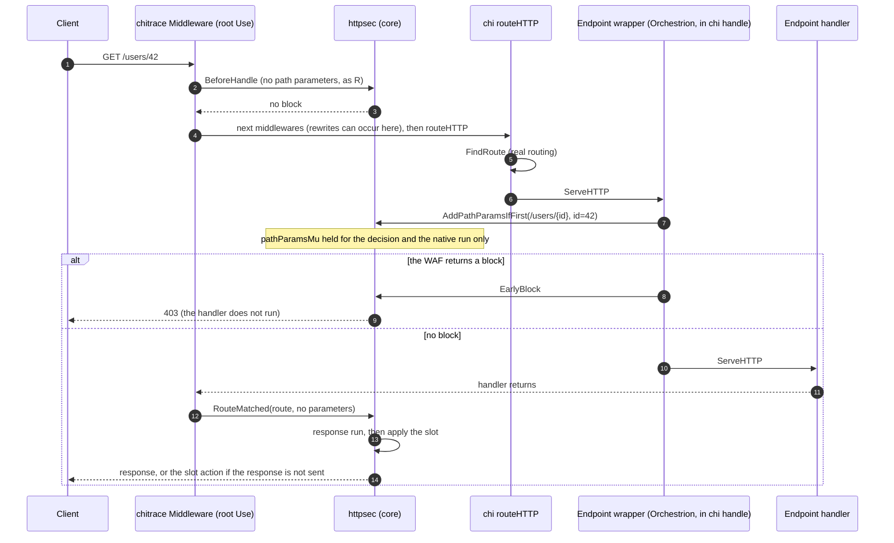

# Design: AppSec path parameters in the chi contribs (`Use` before routing)

> **Status: draft, for design review only.** This file has no code change. It
> can be removed before merge. Romain decides D1–D6 (section 6).
> Origin: ROMAIN-51 (follow-up of DD-20 / PR #5847).

Code references are at dd-trace-go `main` `b3dc60f72`, chi `v5.3.0` and
`v1.5.5`, go-libddwaf `v5.1.0`.

## What changed since v1

1. **Recommendation (changed):** R stays the default. New recommendation:
   **R + docs now**. P comes later, and only if Romain accepts D2–D5. If P
   comes, the preferred mechanism is **M4** (exact hook with Orchestrion), not
   M1. v1 recommended M1, on by default.
2. **No parity claim (changed):** v2 does not say that M1 gives the same result
   as `r.With`. M1 is only an opt-in option, off by default, and it is not
   recommended.
3. **New finding:** objections 3 and 5 are not specific to M1. Every option that
   keeps path parameters in the request WAF context has them: M1, M4, M5, and
   `r.With` today. Only R keeps all R controls (section 1).
4. **Core contract (changed):** v1 row 2 is deleted. The v1 merged run in
   `BeforeHandle` is replaced by 1 separate core function. The lock now has a
   name, a scope and an order. The v1 counter of unapplied actions is deleted. A
   slot state machine is specified for the case D4 = "core change" (section 3).
5. **Decisions (changed):** v1 D2 is split into D2 (lost block) and D3 (lost
   report). New: D4 (action precedence) and D5 (mixed values). v1 D3 (recovery
   tools) is deleted: an opt-in is its own off switch.
6. **Withdrawn from v1:** rule 7 ("the debug log diagnoses a wrong lookup"), the
   AC1 "exceptions", the v1 compatibility rows for sub-routers and Orchestrion,
   and the v1 diagram (M1 on by default).

### Changes after challenge round 2

1. **Docs guidance (section 1):** the example now shows
   `g.Use(Middleware()); g.Get(...)` on the mux that registers the **leaf**
   endpoint. `Group.Use` around `Route(...)` or `Mount` does not get the
   child's parameters. A placement table with span counts is added.
2. **Trade-off text (section 1):** root `Use` against leaf instrumentation, and
   the number of spans.
3. **Section 3:** it is a proposal for a later P, not approved. The open
   blockers #3, #4 and #5 are listed.
4. **Corrections:** D (DD-20) is an independent WAF context, not a subcontext.
   The M1 warning has a new limit: a middleware can answer without calling
   `next`.
5. **Decisions (section 6):** D1a is complete by itself. D2–D5 are deferred if
   D1a is chosen. New item D6 (rollout and rollback). D4 = accept waives a
   requirement. "Reject P" and "require a proven core fix" are now separate.
   D1b authorizes a spike only.
6. **Acceptance criteria (section 5):** the AC for R + docs are marked: AC9 and
   AC13.

---

## 1. Re-evaluated recommendation

**Facts**
- The vote (P = 5, tie = 1) supports **matched** parameters before the handler,
  in the same WAF context. It does not support a prediction before routing.
  - P = Java, Python, Node.js, Ruby, .NET. Tie = PHP. R = 0. D = 0.
  - P means "R + a post-routing hook": 1 WAF context, 1 budget, 1 action slot.
- With `Use` before routing, only `r.With`/`Group`, M4 and M5 give matched
  parameters. M1 is a prediction.
- Every option that keeps path parameters in the request WAF context changes
  some R controls. This table lists them:

| Control (R result) | R test | Cause of the change | Fix |
|---|---|---|---|
| **B1** The parameters of an earlier integration are not replaced and not mixed | `TestEnclosingIntegrationInput`, `TestEnclosingIntegrationCombination`, `TestParentNameOmitted` | a new chi write after them | Core record + lock: chi writes only when the context has no path parameters yet (section 3). Possible for every P option. |
| **B1'** A later integration with other values does not mix with chi values | new control (AC7) | the WAF keeps condition matches between runs | No fix while the values persist. Only R or an independent WAF context (D) keeps it. → D5 |
| **B2** A response block is not lost to the budget | `TestFiniteBudget` | the path rules use the shared budget | Core: a path-parameter run with its own timer (section 3.4), or accept. → D2 |
| **B3** A later report is not lost | `TestEventCapBoundary`, same-type monitor rule (AC8) | (a) path events count toward the 10-event cap; (b) the native WAF does not report a second monitor rule of the same type (`testutil_appsec_test.go:25-28`) | (a) Core: own bound for path events. (b) No fix in dd-trace-go. → D3 |
| **B4** A pending action is not replaced | `TestPendingAction` + response variants (AC8) | the response run uses the kept path values, and the slot uses `Store` (latest wins) | Core change of action semantics (section 3.3), or accept. → D4 |

**Conclusion:** no option that adds path parameters for `Use` before routing is
safe for B4 without a change of the core action semantics. B3(b) cannot be
fixed in dd-trace-go. If Romain requires all R controls, the answer is **R (+
docs)**. Today, `r.With` and the dd `ServeMux`, fiber, gin, echo and gorilla
integrations have the same core behavior for B1'–B4. This is a fact, not a
proof that P is safe.

**Options**

| | R + docs (`r.With`) | R + M1 opt-in | M4 (Orchestrion, exact) | M5 (chi upstream hook) |
|---|---|---|---|---|
| Parameters | matched | **predicted**, with fallbacks | matched | matched |
| Who gets P | users who change their routes | users who set the option | all Orchestrion builds (Orchestrion adds `Use` at the root) | users of a new chi and dd-trace-go |
| User code change | yes (`r.With`, or `Use` in a `Group` that registers the leaf) | yes (1 option) | no | none, or 1 line |
| Objection 1 (wrong route) | no | yes, partly unfixable | no | no |
| B1 | as `r.With` today | kept (core record) | kept (core record) | kept (core record) |
| B1', B2, B3, B4 | as `r.With` today | D2–D5 | D2–D5 | D2–D5 |
| Core change | none | new function, record, lock (+ slot if D4) | same as M1 | same as M1 |
| Unknowns | root `Use` + leaf instrumentation gives 2 spans on a matched request (checked, see the placement table). | rewrite after `Middleware` | spike: inject into chi `(*Mux).handle`. Precedent: `contrib/net/http/orchestrion.server.yml:12-33` (linkname + prepend into `net/http`) | go-chi maintainers accept it; release time |
| Effort | ~2 h | ~17 h (+10 h slot, +3 h timer) | spike 8 h + ~10 h (+ the same core work) | upstream PR ~4 h + unknown wait, then ~8 h |

**Recommendation**
1. **Now: R + docs.** The default does not change. Update the `Middleware`
   godoc (`chi.v5/chi.go:34-45`, `chi/chi.go:31-42`) and
   `internal/appsec/README.md:369-386`. Show the placements below. List the span
   trade-off.
2. **Later, only if Romain accepts D2–D5** (or the AppSec owners agree to the
   core changes): M4, with a spike first. M5 can be proposed upstream at the
   same time.
3. **M1 opt-in: not recommended.** It is a prediction with an unfixable case
   (objection 1). It also needs a user code change, and `r.With` or a `Group`
   already gives matched parameters with a small code change.

### 1.1 Docs guidance: where to put `Middleware()`

Put the middleware on the mux that registers the **leaf** endpoint. Both forms
below give the path parameters to AppSec before the handler:

```go
r := chi.NewRouter()

// 1. With: on the endpoint.
r.With(chitrace.Middleware()).Get("/users/{id}", handler)

// 2. Group: Use, then register the endpoint directly on the same group.
r.Group(func(g chi.Router) {
	g.Use(chitrace.Middleware())
	g.Get("/users/{id}", handler)
})
```

Do **not** expect the child's parameters when `Group.Use` is around `Route(...)`
or `Mount`. The group middleware runs before the child router does its own
routing. It sees the mount pattern (`/docs/*`) and the mount remainder, not the
`id` of the child endpoint:

```go
r.Group(func(g chi.Router) {
	g.Use(chitrace.Middleware()) // sees "/docs/*", not the child's {id}
	g.Route("/docs", func(c chi.Router) {
		c.Get("/{id}", handler)
	})
})
```

`Group` builds an inline mux with `With`. `Route` creates and mounts another mux
(chi v5 `mux.go:235-278`; v1 `mux.go:224-268`).

**Placement table (adversarial review, round 2).** The Adversarial Reviewer ran
the real chi contrib middleware with `mocktracer` on `b3dc60f72`, with chi
v5.3.0 and v1.5.5. The results are the same on both versions. AppSec was off
for this span and dispatch check.

| Placement | What the middleware saw | Chi spans |
|---|---|---:|
| Root `Use` only | No pattern or `id` at entry | 1 |
| `With` on the endpoint, or `Group.Use` with `Get` registered directly on that group | `/users/{id}`, `id=42` | 1 |
| Root `Use` **plus** either endpoint placement | Root saw no params; inner middleware saw `id=42` | **2, parent and child** |
| `Group.Use` around `Route("/docs", child)` | `/docs/*` and the mount remainder, **not** the child's `id` | 1 |
| Group only, unmatched path / wrong method | Group middleware never ran (404 / 405) | 0 |

### 1.2 Trade-off: root `Use` against leaf instrumentation

- **Replace** root `Use` with leaf instrumentation: the leaf gets the matched
  parameters, but AppSec loses the coverage of **unmatched requests** (404, 405)
  and of **work before dispatch** (for example the middlewares before routing).
  The table shows 0 spans for an unmatched request with a group only.
- **Stack** root `Use` and leaf instrumentation: the root keeps that coverage.
  The cost is a child span on each matched request (2 spans).
- Orchestrion already adds `Use(Middleware())` at the root. With Orchestrion,
  adding leaf instrumentation is the "stack" case.
- **2 spans do not mean 2 WAF contexts.** The child middleware reuses the WAF
  context of the request, when it finds one. Whether the child gets the
  parameters first is the B1 control (section 3.1).

---

## 2. Answers to objections 1–5 and AC10

| # | Answer | Proof |
|---|---|---|
| 1 | Partly fixed with fallbacks F1a–F1f. **A rewrite or a method change after `Middleware` cannot be fixed with M1.** | AC1 |
| 2 | Row 2 is deleted (fix). **Mixing with a later writer cannot be fixed with M1** (nor M4, M5) while the values persist. | AC6, AC7 |
| 3 | **Cannot be fixed with M1** (nor M4, M5) without a core change of action semantics. | AC8, D4 |
| 4 | Fixed by specification: lock name, scope and order; slot transitions; barrier tests. The counter is deleted. (Round 2 found gaps for a later P: section 3.) | AC3, AC4 |
| 5 | Split into D2 and D3. Core alternatives are given. B3(b) cannot be fixed in dd-trace-go. | AC8 |
| AC10 | Qualified: a fresh writable response, a fresh sampling key, and separate assertions. | AC12 |

**Objection 1 — fallbacks for the M1 opt-in.** The lookup result is used only
when all these conditions are true. Otherwise chi uses `known` (the R result).
- **F1a** Root only: `len(rctx.RoutePatterns) == 0`. A `Use` in a sub-router
  uses `known`.
- **F1b** The lookup found an endpoint (`Find != ""`, or `Match == true` in v1).
- **F1c** The last pattern does not end with `/*`. This covers an opaque mount
  and a catch-all wildcard: the lookup cannot tell them apart (`/docs/*`).
- **F1d** The last pattern is not a mount pattern or a mount alias such as
  `/api` or `/api/`. This uses a cached route-table check, as
  `unmatchedSubrouter` does (`chi.v5/chi.go:137-178`). Probe: `GET /api` gives
  `Find = "/api"` and status 404.
- **F1e** No name is used 2 times, except mount `*` values that are all `""`
  after rule 4 of v1.
- **F1f** `rctx.RouteMethod == ""` when the lookup runs.

**Cannot be fixed with M1:** a middleware after `Middleware` can change
`rctx.RoutePath`, `r.URL.Path`, `r.URL.RawPath` or `rctx.RouteMethod` (for
example `CleanPath`, `URLFormat`, `GetHead`, or custom code). The lookup runs
before that code, and no chi state tells about a future change. A wrong
prediction can block a valid request, and routing never runs after an early
block, so no log can find it. A middleware can also **answer without calling
`next`** (for example a cached response, or a redirect), with no rewrite: the
predicted parameters were then sent to the WAF for a request that never reaches
routing. The opt-in docs must say: "Use this option only when no middleware
after `Middleware` changes the path or the method, and none answers without
calling `next`."

**Objection 2.**
- Row 2 is deleted. Every non-P write is as `main`, including the write of a
  child's `known`. There is no deduplication by map inclusion. Nested chi
  tracers (Orchestrion) write `known` as `main`. With them, P gives a smaller
  gain.
- **Cannot be fixed:** a P write that persists can be followed by a writer with
  other values (a second router on a changed path). The WAF keeps the condition
  matches. Only R, or an independent WAF context (D), avoids this. D is not a
  subcontext: it does not inherit the state of the request context, so it also
  loses the shared response-rule and schema behavior. → D5.

**Objection 3.** The P values persist. `afterHandle` runs the response WAF
(`httpsec/http.go:440`) before it applies the slot (`:443`), and the listener
uses `Store` (`:131-133`). So a response rule that uses a P value can replace a
pending body block. This needs no sibling and no ignored error. To fix it, the
core action semantics must change ("the first reserved action of the WAF context
wins", section 3.3). This change also changes `r.With` and the other
integrations. → D4.

---

## 3. Core contract — Proposal for a later P, not approved

This section is a proposal for a later P. It is **not** an approved
implementation contract. It applies only to options that keep path parameters
(M1 opt-in, M4, M5). It does not apply to R + docs.

**Open blockers (challenge round 2).** These block P, not the R + docs change.
They stay open until the AppSec owners answer.
- **#3 — slot owner.** The shared slot has no enforcement owner. "Any operation"
  can apply a reservation to its own writer, or its `Finish` can mark a
  sibling's action as failed. The spec must name the owning response and
  callbacks, who can fail or finalize it, and how direct callers of
  `StartOperation` (it returns a mutable `*atomic.Pointer[actions.BlockHTTP]`)
  follow the CAS protocol.
- **#4 — lock order and `added`.** The claimed order "never taken while holding
  a dyngo lock" is false: `dyngo.emitEvent` holds its registry read lock while
  it calls the HTTP listener, and that listener calls `op.Run` with path data
  (`instrumentation/appsec/dyngo/operation.go:379-392`;
  `internal/appsec/listener/httpsec/http.go:69-82`). The spec must give the real
  order, rule out the reverse edge, and define if `added` means *attempted* or
  *accepted* (unsupported data, close, partial timeout).
- **#5 — the detached timer.** The own timer of D2 isolates only the **first**
  run. A response-first rule can defer the path work to the ordinary shared-budget
  response run (`testutil_appsec_test.go:57-65`). Passing `TestFiniteBudget` with
  an uncharged first run does not prove that every baseline block survives.

### 3.1 Write rule (changed: 1 rule, no row 2)
New function in `instrumentation/appsec/emitter/httpsec`. The AppSec owners can
change the name.

```go
// AddPathParamsIfFirst gives params to the WAF context of ctx only if no
// integration gave path parameters to this context before. It returns
// added=false when it did not write. It returns a *events.BlockingSecurityEvent
// when the WAF blocks; the action goes into the action slot (section 3.3).
func AddPathParamsIfFirst(ctx context.Context, route string, params map[string]string) (added bool, err error)
```

- M1 opt-in calls it after `BeforeHandle` and before `next`. M4 and M5 call it
  in the endpoint wrapper. On a block, chi emits `httpsec.EarlyBlock{}`, as gin
  does (`contrib/gin-gonic/gin/appsec.go:47`), and does not call the handler.
- "Gave path parameters" = a context run (not a subcontext, not RASP) whose data
  has `server.request.path_params`. This covers `StartOperation` (direct or
  through `BeforeHandle`), `RouteMatched` with parameters, and this function.
- Nothing changes for the other writers. They always write, as in `main`.

### 3.2 Lock (changed; see open blocker #4)
- **Name:** `ContextOperation.pathParamsMu` (`sync.Mutex`), new, in
  `internal/appsec/emitter/waf/context.go`.
- **Who takes it:** `ContextOperation.runWAF`
  (`internal/appsec/emitter/waf/run.go:46`), for every context run with path
  parameters or with the if-first marker. All persistent writes go through
  `runWAF`.
- **Held during:** the if-first decision, `runner.Run` (the native run,
  `run.go:56`), and the record update.
- **Released before:** `AddEvents`, `SendActionEvents`, `EmitData`, keep and
  metrics (`run.go:62-118`). So no callback runs while the lock is held, and no
  callback can take it again.
- **Order (as claimed in v2):** `pathParamsMu` → go-libddwaf `Context.mu` (inside
  `Run`, `context.go:245`). It is never taken while a goroutine holds
  `ContextOperation.mu` or the action slot. `AddEvents` takes
  `ContextOperation.mu` after the release. **The claim about dyngo locks is
  false** (blocker #4): the real order with the dyngo registry read lock is open.
- **Not taken** by RASP runs, subcontext runs, or runs without path parameters.

### 3.3 Action slot (new; only if D4 = "core change"; see open blocker #3)
One slot per WAF context, shared by all its `HandlerOperation`s. It replaces the
latest-wins `blockAction` (`httpsec/http.go:58`, `:131-133`). The slot is an
atomic state plus an action pointer. All changes are CAS. No mutex is held
during callbacks or response writes.

| From | Event | To | Effect |
|---|---|---|---|
| Empty | an action `a` is produced (any run) | Reserved(a) | — |
| Reserved(a) | another action `b` is produced | Reserved(a) | `b` is dropped. If `b` reports the block outcome: `SetBlockFailed`. An applied `a` block still has precedence in `Submit`. |
| Reserved(a) | an apply point (early block, `EarlyBlock`, `afterHandle`) of any operation of the context | Applying(a) | Exactly 1 caller wins the CAS. A losing caller returns "handled" and writes nothing. |
| Applying(a) | `CommitBlockResponse` succeeds | Applied(a) | `blockApplied`, `SetRequestBlocked` |
| Applying(a) | commit error, or a panic in `OnBlock` or in the handler | Failed(a) | `blockFailed` (deferred, as `http.go:327-332`) |
| Reserved(a) | response already started, blocking unavailable, or `Finish` with no apply | Failed(a) | as `http.go:307-320` and `:199` |
| Applied / Failed | another action `b` | no change | `b` is dropped (`SetBlockFailed` if it reports the outcome) |

Reservation (CAS) is separate from callbacks and from the response write.

### 3.4 Budget and reports
- **D2 = accept:** shared budget (`DD_APPSEC_WAF_TIMEOUT`, default 2 ms).
- **D2 = core change:** the if-first run uses `TimerKey = ""`. go-libddwaf then
  makes a timer that is not charged to the context (`runner.go:50-56`, used at
  `context.go:194`). Cost: the WAF time of a request can be higher than the
  budget. This needs a metric scope, because `metrics.go:356-361` uses
  `TimerKey`. A probe on a context run is necessary: the DD-20 probe used a
  subcontext. **Limit (blocker #5):** this isolates the first run only. It does
  not isolate path work that a response-first rule defers to the shared-budget
  response run.
- **D3 = accept:** the path events count toward the 10-event cap. Same-type
  suppression can hide a later monitor event.
- **D3 = reject:** there is no P. B3(b) is native WAF behavior.

---

## 4. Sequence: M4 (the preferred P mechanism, if D2–D5 allow it)



---

## 5. Acceptance criteria

**For R + docs (D1a):** only **AC9** (with the opt-in off: no changed
expectation) and **AC13** apply. All the other AC apply only to a later P.

**[unit test]**
- [ ] AC1 (M1 opt-in only) Lookup controls, run on chi **v5.3.0 and v1.5.5**.
  Each case is a pass/fail control: rewrite before a child `Use`, rewrite after
  `Use`, mount and terminal wildcard on `/docs/*`, mount stub `/api` with no `/`
  child, a name at 2 levels, `GetHead`, root `RoutePath` change. Expected: `known`
  (the R result) for all cases that F1a–F1f cover. For the "change after
  `Middleware`" cases, the test pins the wrong-prediction result, and the opt-in
  docs list it.
- [ ] AC2 `AddPathParamsIfFirst`: no path parameters → write. Path parameters
  from `BeforeHandle`, a direct `StartOperation`, or `RouteMatched` → no write.
  Subcontext and RASP runs do not count.
- [ ] AC3 Lock barriers, with `-race` and a timeout:
  - a hook stops inside the critical section; a concurrent `RouteMatched` with
    parameters waits, and the result is 1 serial order;
  - the other writer goes first → no P write;
  - a matching rule with an action in the if-first run → no deadlock
    (`AddEvents` and the actions run after the release).
- [ ] AC4 (only if D4 = core change) Slot transitions: each row of 3.3. Two
  apply points race → exactly 1 `Applying`. Panic in `OnBlock` → `Failed` +
  telemetry. `Finish` with `Reserved` → `Failed`.

**[integration test, real WAF]** (both packages, `httptest` server)
- [ ] AC5 Gains (M1 opt-in on, or M4): a rule on `id` blocks before the handler;
  [response header + `id`] gives 403; the schema has `_dd.appsec.s.req.params`.
- [ ] AC6 B1 = R: the 3 B1 tests in section 1. New strict-superset control: an
  enclosing non-P map that contains more than the child `known`, a child `Use`
  with the opt-in on, and a response-first rule on the parent-only key → the
  `main` result.
- [ ] AC7 B1' (pinned, for D5): a successful first P write, then a second router
  on a changed path with other values, and a rule that needs 1 value of each. The
  test pins the result: expected 403, R gives 200.
- [ ] AC8 R controls with P on. The test checks the wire action, the timeout and
  the reported rule IDs separately:
  - `TestFiniteBudget`: D2 = accept → pinned 200 and `waf_timeout:true`. D2 =
    core change → 403 is kept.
  - `TestEventCapBoundary`, and a new same-type monitor test below the cap (a P
    path monitor of type T, then a header monitor of type T): D3 = accept → the
    lost header event is pinned.
  - Pending body block + path/response redirect, and the inverse: D4 = accept →
    the latest-wins results are pinned. D4 = core change → the original wire
    action and its telemetry.
- [ ] AC9 **(R + docs)** R default: with the opt-in off, or without Orchestrion,
  all chi tests at `b3dc60f72` pass with no changed expectation. If D4 = core
  change, the PR lists each changed test of the other integrations, with the
  reason.

**[benchmark]**
- [ ] AC10 `BenchmarkMiddlewareAppSec`, `-count 10`, benchstat. Opt-in off: no
  change in allocations; ns/op within noise. Opt-in on (or M4): report the
  change.
- [ ] AC11 Default rules, path values of 8, 64 and 256 bytes: report the change
  of `_dd.appsec.waf.duration`.

**[telemetry]** (`testutils.StartTelemetryRecorder`)
- [ ] AC12 (replaces v1 AC10)
  - Positive case: a fresh writable response and a fresh sampling key (as
    `TestAppSecSchemaPerEndpoint`, `setups_appsec_test.go:352`). A P block gives
    1 `waf.requests` point with `request_blocked:true` and `block_failure:false`.
  - An early-blocked request keeps the start route: the late route callback does
    not run (`chi.v5/appsec.go:60-74`).
  - A P block after the response started (a middleware before `Middleware`
    flushed): `block_failure:true`, and the handler does not run
    (`httpsec/http.go:312-320`).
  - Route attribution is checked on the operation route and the span route, not
    from a zero `api_security.missing_route` (it counts only 2xx,
    `listener/httpsec/http.go:115`).

**[system-tests]**
- [ ] AC13 **(R + docs)** The `chi` weblog jobs pass with no manifest change (the
  R default does not change).

**[integration test, CI]**
- [ ] AC14 apidiff shows additions only. Go 1.26 and 1.27, `-race`,
  `GOWORK=off`. If M4: `internal/orchestrion/_integration/chi` and `chi.v5` pass,
  with a new path-parameter case.

---

## 6. Decisions for Romain (changed)

**D1a is complete by itself.** If Romain chooses **D1a**, the decision ends
here: D2–D6 are **deferred**. Nothing in D2–D6 is needed to ship R + docs.
Only AC9 and AC13 apply.

**D1 — Mechanism**
- a. **R + docs only (recommended now).** Complete by itself. D2–D6 deferred.
- b. R + docs now, then M4, if D2–D6 allow it. **This authorizes a spike only**,
  not an implementation. The spike must prove that the new hook runs only on a
  leaf (chi `(*Mux).handle` also registers mount stubs, `mux.go:324-338`), and
  that it respects disabled and ignored instrumentation. In a traced child, an
  ordinary mount `*` can already occupy the first-write slot: the spike must
  specify the skip that follows, and not promise full endpoint coverage.
- c. R + M1 opt-in (not recommended).
- d. M5: propose a hook to go-chi (can run at the same time as b).

**D2–D6 are deferred if D1a is chosen.** They apply only to a later P.

**D2 — Lost baseline block (B2/L2).** A response block of R can be lost when
the path rules use the budget (`TestFiniteBudget`: 403 → 200).
- Accept.
- Reject, with a core change: a separate timer for the path-parameter run. The
  WAF time of a request can then exceed `DD_APPSEC_WAF_TIMEOUT`. A probe is
  necessary. The timer isolates the first run only (blocker #5).
- Reject: no P.

**D3 — Lost baseline report (B3/L3).** A later event can be lost to the
10-event cap or to native same-type suppression.
- Accept.
- Reject: no P. Same-type suppression cannot be changed in dd-trace-go.

**D4 — Action precedence (B4).** A response action that uses a P value can
replace a pending action, as with `r.With` today.
- Accept. **"D4 = accept" waives the requirement "never replace a pending
  action"** of the issue.
- Core change: "the first reserved action of the WAF context wins" (section
  3.3). This changes all integrations. The AppSec owners must approve it. It is
  not the only conceivable core change.
- Reject: no P.

**D5 — Mixed values with a later writer (B1').** A rule can match 1 P value and
1 value of a later integration. This is the same kind of false block as DD-20
item 2 (AC7).
- Accept.
- Reject: no P.

**D6 — Rollout and rollback (new; only for a later P).** Choose the off switch
before any P ships.
- The M1 opt-in is its own off switch for M1 only. It does **not** turn off an
  M4 that Orchestrion applies to all builds.
- A D4 core change also affects requests that do not use P. The off switch of P
  does not undo it.
- Decide: the rollout (opt-in, or default on), the rollback (an option, a
  release revert, or Remote Config), and whether each core change can be
  reverted on its own.

**Planner:** no recommendation for D2–D5. Each one is a policy choice: it
accepts a loss compared with R, for the users who get P.

**How to read a "no" on D2–D5.** Two different answers exist:
- **Reject P:** P is not built. D1 = a.
- **Require a proven core fix:** P stays possible, but only after the core fix
  for that point is built **and proven** (for example the D2 timer with a
  deferred-evaluation control, or the D4 slot with the AC4 tests). Until then,
  D1 = a.

## 7. Review requirements
1. Adversarial challenge round 2 on v2: **done**. The open objections are in
   section 3 (blockers #3, #4, #5).
2. Romain decides D1–D6 at the gate.
3. If P is chosen: `@DataDog/asm-go` approves the core contract (3.1–3.4) on the
   dd-trace-go PR (`CODEOWNERS:67-72`), and the contrib owners (`CODEOWNERS:60`)
   approve the contrib change.
4. If M4: `@DataDog/apm-orchestrion` (`CODEOWNERS:149`) approves the new aspect
   in `orchestrion.yml`.
