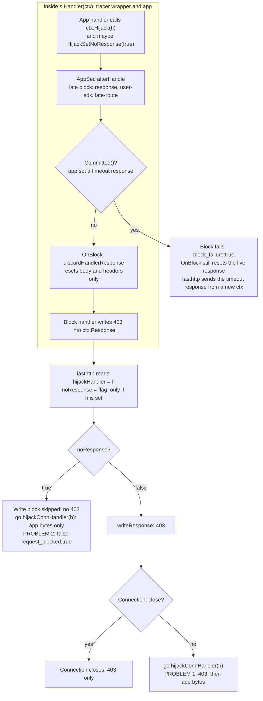
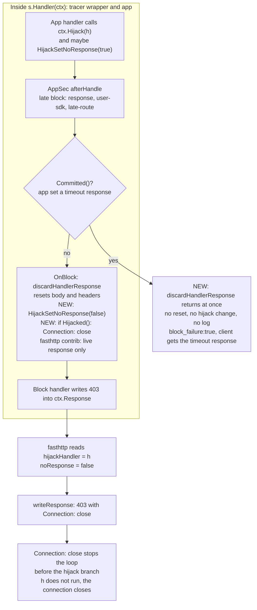

# AppSec: stop the fasthttp hijack handler after a block

> **Temporary document.** Remove it before the PR merges.
>
> Revision: v2 (answers the first adversarial review).
>
> Scope: `contrib/valyala/fasthttp` (fasthttp `v1.75.0`) and
> `contrib/gofiber/fiber.v2` (fasthttp `v1.70.0`). These are the only contribs
> that use `valyala/fasthttp`. Code references are at `main` `c2937d8f8`.

## 1. Summary

**Problem.** After a late AppSec block, fasthttp still runs the hijack handler
of the application. Two results on the wire:

1. **Extra bytes after the block.** Keep-alive request, app calls
   `ctx.Hijack(h)` and `h` writes to the connection. The client gets the 403,
   then the bytes of `h`.
2. **No block at all.** App also calls `ctx.HijackSetNoResponse(true)`. fasthttp
   does not send the 403. The client gets only the bytes of `h`. The span
   (`appsec.blocked=true`, `http.status_code=403`) and the metric
   (`waf.requests` `request_blocked:true`) say "blocked". This is false.

Both problems occur in all late phases: `response`, `user-sdk` (also RASP,
same path), and `late-route` (fiber.v2 only). Early blocks are clean, because
the app handler does not run. Real-server, real-WAF spikes confirmed both
problems in both contribs (fasthttp at `b3dc60f7`, fiber.v2 at `a360df22`).

**Fix.** In `discardHandlerResponse` (the `OnBlock` callback of each contrib):

1. If `Committed()` is true, return at once. The block failed, and another
   goroutine can still use the context.
2. Call `ctx.HijackSetNoResponse(false)`. fasthttp then always sends the block
   response.
3. If `ctx.Hijacked()` is true, set `Connection: close` on the block response.
   fasthttp then does not call the hijack handler. This is the documented
   contract of `RequestCtx.Hijack`.

Do **not** call `ctx.Hijack(nil)`. Section 4.2 explains why (gap G4).

**Size.** Production code: about 25 lines in 2 files. Tests: about 500 to 700
lines in 2 new test files (1 for each module). No `go.mod` change.

## 2. Root cause

- fasthttp reads the hijack state only after the full handler chain returns:
  `v1.75.0 server.go:2756-2759`, `v1.70.0 server.go:2527-2530`.
- AppSec writes a late block inside that chain, in `afterHandle`
  (`instrumentation/appsec/emitter/httpsec/http.go:436-444`).
- Before it writes the block, AppSec calls `discardHandlerResponse`
  (`http.go:334-336`). This resets the body and the headers. It does not change
  the hijack state.
- Then fasthttp does this:
  - `hijackNoResponse` is false: it sends the 403 (`v1.75.0 server.go:2812`),
    then it gives the connection to `h` (`server.go:2867`). This is problem 1.
  - `hijackNoResponse` is true: it skips the full write block
    (`server.go:2808-2844`), then it gives the connection to `h`. This is
    problem 2.
  - `Connection: close` (request or response) and `hijackNoResponse` is false:
    it stops before the hijack (`v1.75.0 server.go:2837`,
    `v1.70.0 server.go:2581`). This case is clean today.
  - `Connection: close` and `hijackNoResponse` is true: the close check is
    inside the skipped write block, so `h` runs. This is problem 2 again.
    (Code-read, confirmed by the adversarial review. The spikes did not test
    it.)

The documentation of `RequestCtx.Hijack` (`v1.75.0 server.go:754-777`,
`v1.70.0 server.go:707-730`) says: "The server skips calling the handler in
the following cases: 'Connection: close' header exists in either request or
response."

## 3. Lifecycle: before and after the fix

### Before (`main`)



### After (this proposal)



A blocked request with **no** hijack does not get `Connection: close`. Its
connection stays open, as on `main`.

## 4. Proposed approach

### 4.1 Hook point

**Chosen:** `discardHandlerResponse`, the `OnBlock` callback:
`contrib/valyala/fasthttp/appsec.go:196-202` and
`contrib/gofiber/fiber.v2/appsec.go:294-314`. Its first line is a new
`Committed()` guard.

All blocks go through `applyBlockAction`. It calls `OnBlock` on both paths:
block delivered (`http.go:334-336`) and block failed (`http.go:316-318`). The
new guard makes the failed path a no-op. Thus the hijack change runs only when
AppSec writes a block that fasthttp sends. This covers early, late-route,
response, user-sdk and RASP blocks, and all block handlers.

| Option | Where | Result |
| --- | --- | --- |
| **H1 (chosen)** | `discardHandlerResponse`, after a `Committed()` guard | 1 place for each contrib. Runs before any block handler. |
| H2 | Block writer `WriteHeader` | Rejected. It runs only when a block is written. In fiber.v2, it returns early after `blockDone` (`appsec.go:226`). It links hijack handling to the format of the block response. |
| H3 | After-handle code of each contrib (`fasthttp.go:57-60`, `timeout.go:390`, `:421`, `:524`, fiber `appsec.go:136`) | Rejected. 5 call sites. It needs a new "block applied" signal: the fasthttp contrib has no `blockDone`. It is easy to forget one site. |
| H4 | `httpsec` (shared) | Rejected. `httpsec` uses `net/http` types. The core module has no fasthttp dependency. It needs a new optional interface for 2 contribs. |

### 4.2 What the hook does

Facts from fasthttp (both pinned versions):

- `Hijack(h)` stores `h`. `HijackSetNoResponse(b)` stores `b`. `Hijacked()` is
  `h != nil`. There is no getter for `h` or for the flag
  (`v1.70.0 server.go:731-747`, `v1.75.0 server.go:778-794`).
- fasthttp reads the flag as `ctx.hijackNoResponse && hijackHandler != nil`
  (`v1.75.0 server.go:2758`, `v1.70.0 server.go:2529`). Without `h`, the flag
  has no effect.
- With `h` set and `Connection: close`, fasthttp writes the response, stops
  its loop, and does not call `h` (documented, section 2). It does not return
  the `RequestCtx` to its pool, because `h` is set
  (`v1.75.0 server.go:2898`, `v1.70.0 server.go:2638`). The worker pool closes
  the connection (`workerpool.go:237-241`).
- With `h` removed (`Hijack(nil)`), fasthttp continues its keep-alive loop on
  the connection. It resets the `RequestCtx`, reads the next request into it,
  and at the end returns it to the pool.

A native `ctx.Hijack(h)` only registers `h`: nothing goes to the connection
before the handler returns. But `fasthttpadaptor.NewFastHTTPHandler` (and
`fiber/v2/middleware/adaptor`, which uses it) is different. When the adapted
`net/http` handler calls `Hijack()`, the adaptor gives the **live** connection
to the `net/http` goroutine before the fasthttp handler returns. Then it calls
`HijackSetNoResponse(true)` and `Hijack(func(net.Conn) { conn.wg.Wait() })`
(`v1.75.0 fasthttpadaptor/adaptor.go:440-469`,
`v1.70.0 fasthttpadaptor/adaptor.go:298-327`). AppSec cannot tell this live
hijack from a native one. This is gap G4.

| Mechanism | Problem 1 | Problem 2 | Live hijack (G4) | Rejected because |
| --- | --- | --- | --- | --- |
| M1 (v1 of this doc): `Hijack(nil)` + `HijackSetNoResponse(false)` | fixed | fixed | **Bad.** fasthttp writes the 403 while the `net/http` goroutine writes. Then it reads the next request from the same connection as that goroutine. It resets and reuses the `RequestCtx` while that goroutine still holds it (`r.Context()`). | The `RequestCtx` reuse can mix data of 2 requests. |
| **M2 (chosen):** `HijackSetNoResponse(false)` always, `Connection: close` if `Hijacked()` | fixed | fixed | **Less bad.** fasthttp writes the 403 while the `net/http` goroutine can also write (bytes can mix). Then the connection closes, and the `net/http` goroutine gets I/O errors. No second read, no `RequestCtx` reuse. | (chosen) |
| M3: `Connection: close` only | fixed | not fixed | same as main | With `noResponse`, the close check is in the skipped write block. |
| M4: `Hijack(nil)` + `HijackSetNoResponse(false)` + `Connection: close` | fixed | fixed | fasthttp returns the `RequestCtx` to the pool while the `net/http` goroutine holds it | `h` must stay set to keep the `RequestCtx` out of the pool. |
| M5: report `Hijacked()` as `Committed()` (as `#5881` did for `net/http`) | not fixed | not fixed | safe | It removes 403s that reach the client today (problem 1 rows). This breaks the hard rule. |
| M6: replace `h` with a no-op handler | — | — | — | There is no getter for `h`, so it cannot be wrapped. A no-op `h` with `noResponse` still sends no 403, and fasthttp returns the `RequestCtx` to the pool after `h`. |

Guards:

- `HijackSetNoResponse(false)`: **always** (after the `Committed()` guard). It
  costs 1 store. Without `h`, it has no effect. If code outside the AppSec
  scope calls `Hijack(h2)` later (gap G1), fasthttp still sends the 403.
- `Connection: close`: **only if `Hijacked()`**. A blocked request with no
  hijack keeps its connection open, as on `main`.
- Debug log (decision D1): only when this call sets `Connection: close`. The
  second call of the same request (fiber `WriteHeader`, second block) does not
  log again.

### 4.3 Code shape (to clarify the interface, not final code)

`contrib/valyala/fasthttp/appsec.go`:

```go
func (w *responseWriter) discardHandlerResponse() {
	// A failed block writes nothing, so do not touch the context. After
	// TimeoutError*, another goroutine can still use it, and fasthttp sends
	// the timeout response from a new context.
	if w.Committed() {
		return
	}
	if !w.wroteHeader {
		w.response.ResetBody()
		w.response.Header.Reset()
	}
	// Only the live response belongs to the context. For the detached
	// response of the timeout layer, the worker can still use the context,
	// and fasthttp sends that response from a new context.
	if w.response == &w.ctx.Response {
		stopHijack(w.ctx)
	}
}

// stopHijack makes fasthttp send the block response. If the application set
// a hijack handler, the block response closes the connection, so fasthttp
// does not call the handler (see RequestCtx.Hijack). The handler stays set:
// fasthttpadaptor can have given the live connection to a net/http handler,
// and fasthttp must not read that connection again or reuse the context.
func stopHijack(ctx *fasthttp.RequestCtx) {
	ctx.HijackSetNoResponse(false)
	if ctx.Hijacked() && !ctx.Response.ConnectionClose() {
		instr.Logger().Debug("contrib/valyala/fasthttp: AppSec blocked the request: the connection closes after the block response and the application hijack handler does not run")
		ctx.Response.SetConnectionClose()
	}
}
```

The reset runs before `stopHijack`, because `Header.Reset()` also clears the
`Connection: close` flag.

`contrib/gofiber/fiber.v2/appsec.go`: the same helper (copy, 1 for each
module). `discardHandlerResponse` starts with `if w.Committed() { return }`,
then keeps its current `wroteHeader` guard and header reset, then calls
`stopHijack(w.fctx)`. The order is the same as in `contrib/valyala/fasthttp`.
Its reset keeps the `Connection: close` flag (`appsec.go:302`, `:311-313`).
fiber.v2 has no detached response.

The helper is not shared. The 2 contribs are separate modules, and fiber.v2
does not import `contrib/valyala/fasthttp`. A shared helper needs a new
exported API.

### 4.4 Edge cases

| # | Edge case | Code | Behavior with the fix | Why it is safe |
| --- | --- | --- | --- | --- |
| E1 | fasthttp timeout layer, deadline. The block goes into the detached `l.response`. | `timeout.go:444-459`, `appsec.go:182-184` | `Committed()` is false and does not read `ctx`. The reset applies to `l.response`. `stopHijack` does not run. | The worker can still call `ctx.Hijack`. A write from the owner goroutine is a data race. `TimeoutErrorWithResponse` makes fasthttp use a new ctx (`v1.75.0 server.go:2734-2749`), so the old hijack state is never read. |
| E2 | `Committed()` is true (the app called `TimeoutError*`), both contribs. | fasthttp `appsec.go:181-190`, fiber `appsec.go:286-288`, `http.go:312-319` | `discardHandlerResponse` returns at once: no reset, no hijack access, no log. | After `TimeoutError*`, another goroutine can still use the ctx (fasthttp contract), so any access can race. No access is necessary: fasthttp uses a new ctx before it reads the hijack state (`v1.75.0 server.go:2734-2759`, `v1.70.0 server.go:2516-2530`). **Side effect:** the live response is no longer reset on a failed block. The span `http.status_code` then shows the status that the app set (before: 200 after the reset). The wire does not change. |
| E3 | fasthttp timeout layer, live response. | `timeout.go:366` (early block), `:390` (nested scope), `:421` (worker done), `:524` (`finishOuter`) | `stopHijack` runs. | The worker is paused (it waits for the reply) or it has exited. Only the owner uses the ctx. |
| E4 | fiber.v2 `WriteHeader` calls `discardHandlerResponse` again. | `appsec.go:231` | Second call: `stopHijack` stores the same values. No second log. | Idempotent. |
| E5 | fiber.v2 `blockDone` (second block after a delivered block). | `appsec.go:215`, `:226`, `:242`, `:254-257`, `:287` | `Committed()` is true, so the new guard returns at once. | The first block already ran `stopHijack`. No user handler runs after it inside `useAppSec`. |
| E6 | fasthttp contrib has no `blockDone`. | `appsec.go:116-125`, `:149-152` | A second block runs `discardHandlerResponse` again. `wroteHeader` skips the reset. `stopHijack` stores the same values. | Idempotent. The metric of a second block is a different issue (gap G2). |
| E7 | `Connection: close` request. | `v1.75.0 server.go:2837`, `v1.70.0 server.go:2581` | With the flag reset, the write block runs, and fasthttp stops before the hijack. `noresponse-raw-close` is fixed. | Documented contract. |
| E8 | Redirect and other block handlers. | `http.go:334-338` | `OnBlock` runs before any block handler. The fix does not depend on the handler. | dd-trace-go has no block handler from the user. WAF actions select it: block (JSON, HTML) or redirect. A bodyless redirect also calls `WriteHeader`. |
| E9 | Early block. | `http.go:446`, `fasthttp.go:61`, fiber `appsec.go:97` | The app handler does not run. `stopHijack` changes nothing, unless code outside the AppSec scope called `Hijack` before. Then that `h` does not run. | The block must be the last thing on the wire. |
| E10 | Blocking is not available. | `http.go:307-310` | No `OnBlock`. No change. | No block. |
| E11 | Code outside the AppSec scope calls `Hijack` after the scope returns. | outer middleware | Partly fixed (gap G1). | No AppSec code runs after the scope returns. |
| E12 | Live hijack through `fasthttpadaptor` or `fiber/v2/middleware/adaptor`. | `v1.75.0 fasthttpadaptor/adaptor.go:440-469` | Gap G4: the 403 can mix with the bytes of the `net/http` goroutine, then the connection closes. | Mechanism M2 keeps `h` set, so fasthttp does not read the connection again and does not reuse the `RequestCtx`. |
| E13 | `fasthttpadaptor` abort (`http.ErrAbortHandler`). | `v1.75.0 fasthttpadaptor/adaptor.go:208-213` | The adaptor sets `noResponse` and an `h` that closes. With the fix: 403, then close. | The `net/http` goroutine has exited. Nothing else uses the connection. |

### 4.5 Proof for the hard rule: no block that works today goes away

Same result in both contribs (from the spikes). "403" means the block response
only.

| Phase and handler case | `main`, on the wire | With the fix | Block kept? |
| --- | --- | --- | --- |
| `none` (no block), any case | App response. `h` runs. | Same | No block |
| Early block, no hijack | 403, connection stays open | Same | Yes |
| Late block, body or stream (`SetBodyString`, `SetBodyStreamWriter`, `SetBodyStream`, `SendString`) | 403, connection stays open | Same | Yes |
| Late block, `HijackSetNoResponse(true)` with no `Hijack` | 403, connection stays open | Same | Yes |
| Late block, `Hijack(h)`, `h` writes, keep-alive | 403, then app bytes | 403 with `Connection: close`, then close | Yes. Extra bytes removed. |
| Late block, `Hijack(h)`, `h` does not write | 403, then `h` closes | 403 with `Connection: close`, then close | Yes |
| Late block, `Hijack(h)`, request `Connection: close` | 403, then close | Same | Yes |
| Late block, `HijackSetNoResponse(true)` + `Hijack(h)` | App bytes only | 403 with `Connection: close`, then close | Now delivered |
| Late block, `HijackSetNoResponse(true)` + `Hijack(h)`, request `Connection: close` | App bytes only (code-read) | 403, then close | Now delivered |
| Late block after app `TimeoutErrorWithCode(504)` | 504, `block_failure:true` | Same | No change |

Reason: the fix changes only 2 things that `serveConn` reads.
`hijackNoResponse` becomes false, so fasthttp always runs the write block on
the response that holds the block (`server.go:2808-2812`). `Connection: close`
is added only when `h` is set, so the only code that stops running is the
hijack branch (`server.go:2846-2870`). That branch runs after the write, so it
cannot remove a block that was sent. Requests with no hijack keep the same
headers and the same keep-alive behavior.

## 5. Constraints

### Isolation

- Production change: only `discardHandlerResponse` in the 2 `appsec.go`
  files, and 1 unexported helper in each.
- No change in `instrumentation/appsec/emitter/httpsec` or in the core module.
- No exported API change. No `go.mod` or `go.sum` change.
- The tests do not import `instrumentation/testutils/appsecwire`. That package
  imports `golang.org/x/net/http2`, which is not in either contrib `go.mod`.
  Each test file has its own small rules constant, as the current tests do.
- otelc and orchestrion use `WrapHandler` and `Middleware`. They get the fix
  with no change.

### Compatibility

- **Both pinned versions.** `v1.70.0` and `v1.75.0` have the same `Hijack`,
  `HijackSetNoResponse`, `Hijacked`, `Response.SetConnectionClose` and
  `Response.ConnectionClose` (`v1.70.0 http.go:180-187`,
  `v1.75.0 http.go:213-220`). They read the hijack state in the same way, and
  both document the `Connection: close` rule (section 2).
- **The repository `go.work` hides `v1.70.0`.** With the workspace,
  `contrib/gofiber/fiber.v2` resolves fasthttp `v1.75.0`. Only
  `GOWORK=off` tests `v1.70.0` (section 6.2).
- **Newer fasthttp.** Users can get a newer fasthttp through Go module
  resolution. The `go get -u smoke test` CI job runs the tests with the latest
  versions.
- **Hard rule.** Section 4.5. No 403 or redirect that reaches the client today
  goes away.
- **Intended behavior change.** After an AppSec block on a request with a
  hijack, the hijack handler of the app does not run, and the connection
  closes after the block response. This includes WebSocket upgrades
  (`fasthttp/websocket` uses `ctx.Hijack`). An app that releases resources
  only in its hijack handler does not get that call. fasthttp itself already
  skips the hijack handler on `Connection: close` and on a write error, so
  apps cannot depend on it.
- **Gap G4 (live hijack through `fasthttpadaptor`).** See E12 and section 9.
  The 403 can mix with the bytes of the adapted `net/http` handler, then the
  connection closes. On `main`, no 403 goes out, and the `net/http` handler
  continues to the end with a false "blocked" result.
- **Requests that are not blocked.** No change. The new code runs only in
  `OnBlock`.
- **Failed blocks** (`Committed()` is true): the wire does not change. The span
  status can change (E2 side effect).
- The PR description and the release note must say all of this, including G4.

### Rollout

- No feature flag. This is a security fix, on by default.
- It ships in the next release of the 2 contrib modules.
- Monitoring-only rules (no block action) do not call `OnBlock`. No change.

### Recovery

- Revert the fix commit. There is no state, no data and no `go.mod` change, so
  the revert is clean.
- A customer can pin the previous contrib version. We do not recommend this,
  because it brings back the false "blocked" result.

### Performance

- Cost only on blocked requests that are not committed: 1 pointer compare
  (fasthttp contrib), 2 field reads, 1 or 2 field stores. No allocation.
- The debug log has a constant message and no arguments.
- A blocked request with a hijack now closes its connection. fasthttp does
  not start the hijack goroutine, and it does not return that `RequestCtx` to
  its pool (the garbage collector frees it). This is the same as the fasthttp
  path for a hijack with `Connection: close` today.

## 6. Verification

### 6.1 Test matrix (real server, real WAF, both modules)

Use a real `fasthttp.Server` (fiber: `app.Server().ServeConn`, as
`serveOnPipe` does) and the real WAF with custom rules. Tests go first in the
PR (commit 1). The new block rows must fail on `main`.

**Handler cases (rows):**

| Row | What the handler does |
| --- | --- |
| `hijack-raw` | `Hijack(h)`, `h` writes `HTTP/1.1 200 OK ... APP-BODY` |
| `noresponse-raw` | `HijackSetNoResponse(true)` + `hijack-raw` |
| `hijack-nowrite` | `Hijack(h)`, `h` closes the connection |
| `hijack-raw-close` | `hijack-raw`, the request has `Connection: close` |
| `noresponse-raw-close` | `noresponse-raw`, the request has `Connection: close` |
| `noresponse-only` | `HijackSetNoResponse(true)`, no `Hijack` |
| `body` | `SetBodyString` (fasthttp) or `SendString` (fiber) |
| `outer-hijack-before` | Code outside the AppSec scope calls `Hijack(h)`, then calls the wrapped handler |
| `outer-hijack-after` (gap G1) | Code outside the AppSec scope calls `Hijack(h)` after the wrapped handler returns, and the app did not hijack. Expected: same as `main`. |

**Phases (columns):**

- fasthttp: `none`, `early-request`, `response` (response header rule),
  `response-redirect` (response header rule with a redirect action),
  `user-sdk` (`appsec.SetUser` with a blocked user).
- fiber.v2: `none`, `early-wrap`, `late-route`, `response`,
  `response-redirect`, `user-sdk`.

**Expected result in a blocked cell with a hijack:** the client reads 1
response: the block response (403 with the block body, or 303 with
`Location`), with `Connection: close`. Then it reads until the connection
closes. There must be no bytes after the block response. An atomic flag in
`h` must not be set. (If `h` ran, fasthttp calls it before it closes the
connection, so the check after the close is reliable.)

**Expected result in a blocked cell with no hijack** (`body`,
`noresponse-only`): the block response has no `Connection: close`. The test
sends a second request on the same connection, and it gets the normal app
response.

**Expected result in `none`:** same as `main`. `h` runs.

**Timeout rows:**

| Row | Module | Expected |
| --- | --- | --- |
| T1: app calls `TimeoutErrorWithCode(504)`, `hijack-raw`, response block | both | Wire: 504 timeout body. `block_failure:true`. `appsec.blocked` not set. `h` does not run. |
| T2a: `TimeoutHandler`, the worker calls `ctx.Hijack(h)` + `HijackSetNoResponse(true)` **before** the deadline, then waits. Pending `user-sdk` block. Deadline expires. | fasthttp, both wrapper orders | Wire: block response (from `l.response`). `h` does not run. |
| T2b: as T2a, but the worker calls `ctx.Hijack(h)` + `HijackSetNoResponse(true)` **after** the deadline, concurrently with the owner | fasthttp, both wrapper orders | `-race` finds no race. Wire: block response. `h` does not run. |
| T3: `TimeoutHandler`, the worker returns before the deadline, response block, `hijack-raw` | fasthttp, both wrapper orders | Block response with `Connection: close`, then close. `h` does not run. |
| T4: the handler starts goroutine B. B calls `ctx.Hijack(h)` and `ctx.HijackSetNoResponse(true)` concurrently. The handler sets a blocking response header, calls `TimeoutErrorWithCode(504)`, and returns. The test waits for B before it ends. | both | `-race` finds no race. Wire: 504 timeout body. `block_failure:true`. `h` does not run. |

The 2 wrapper orders are `WrapHandler(TimeoutHandler(h))` (`finishOuter`,
`timeout.go:524`) and `TimeoutHandler(WrapHandler(h))` (root worker,
`timeout.go:421`), as in `TestTimeoutHandlerBlockAfterApplicationTimeout`
(`timeout_test.go:1044`).

T4 also checks the debug log: the log condition reads `Hijacked()`. If it ran
on the failed path, `-race` would report the read.

**Unit rows (in-memory `RequestCtx`, `fctx.Init`):**

- Block after `Hijack(h)`: `fctx.Response.ConnectionClose()` is true, and
  `fctx.Hijacked()` is still true.
- Block with no hijack: `fctx.Response.ConnectionClose()` is false.
- No block after `Hijack(h)`: `fctx.Response.ConnectionClose()` is false.

### 6.2 Commands

```sh
# Show the pinned fasthttp version of each module, without the workspace.
cd contrib/valyala/fasthttp && GOWORK=off go list -m github.com/valyala/fasthttp   # v1.75.0
cd contrib/gofiber/fiber.v2 && GOWORK=off go list -m github.com/valyala/fasthttp   # v1.70.0

# Commit 1 only (tests), on main: the new block rows must fail.
cd contrib/valyala/fasthttp && GOWORK=off go test -race -count=1 -run 'Hijack' -v .
cd contrib/gofiber/fiber.v2 && GOWORK=off go test -race -count=1 -run 'Hijack' -v .

# With the fix: all tests of both modules, pinned versions.
cd contrib/valyala/fasthttp && GOWORK=off go test -race -count=1 ./...
cd contrib/gofiber/fiber.v2 && GOWORK=off go test -race -count=1 ./...

# With the fix: fiber.v2 again with the workspace (fasthttp v1.75.0).
cd contrib/gofiber/fiber.v2 && go test -race -count=1 ./...

# Lint, from the repository root.
make lint
```

`GOWORK=off go test` works in `contrib/gofiber/fiber.v2`: its `go.mod` replaces
`github.com/DataDog/dd-trace-go/v2` with `../../..` (checked locally).

The tests skip when the platform has no WAF. The PR evidence must show `PASS`,
not `SKIP`.

## 7. Acceptance criteria

- [ ] **AC1** `[integration-test]` fasthttp: `response`, `response-redirect`
  and `user-sdk` × `hijack-raw`. Wire: block response with `Connection: close`,
  then close, no extra bytes. `h` does not run.
- [ ] **AC2** `[integration-test]` fasthttp: the same phases ×
  `noresponse-raw` and `noresponse-raw-close`. Same result as AC1.
- [ ] **AC3** `[integration-test]` fiber.v2: `late-route`, `response`,
  `response-redirect` and `user-sdk` × `hijack-raw`. Same result as AC1.
- [ ] **AC4** `[integration-test]` fiber.v2: the same phases ×
  `noresponse-raw` and `noresponse-raw-close`. Same result as AC1.
- [ ] **AC5** `[integration-test]` Both: early block × `outer-hijack-before`.
  Same result as AC1.
- [ ] **AC6** `[integration-test]` `[compat]` Both: `none` × all rows. Wire and
  `h` are the same as on `main`. (A WebSocket or hijack app with no block does
  not change.)
- [ ] **AC7** `[integration-test]` `[compat]` Both: early block and late blocks
  × `body` and `noresponse-only`. Wire: block response with no
  `Connection: close`. The second request on the same connection gets the
  normal response.
- [ ] **AC8** `[integration-test]` `[compat]` Both: late blocks ×
  `hijack-nowrite` and `hijack-raw-close`. Wire: block response, then close.
  `h` does not run.
- [ ] **AC9** `[integration-test]` `[compat]` Both: T1. Wire: 504 timeout body.
  `block_failure:true`. `appsec.blocked` not set.
  `TestAppSecBlockAfterApplicationTimeout`, `TestAppSecBlockAfterEarlierTimeout`,
  `TestTimeoutHandlerBlockAfterApplicationTimeout`,
  `TestTimeoutHandlerFailedEarlyBlock` and
  `TestAppSecApplicationTimeoutAfterBlock` pass with no change.
- [ ] **AC10** `[integration-test]` `[race]` fasthttp: T2a and T2b, in both
  wrapper orders, with `-race`. Wire: block response. `h` does not run.
- [ ] **AC11** `[integration-test]` fasthttp: T3, in both wrapper orders. Same
  result as AC1.
- [ ] **AC12** `[race]` Both: T4 passes with `-race`. Wire: 504 timeout body.
  `block_failure:true`.
- [ ] **AC13** `[telemetry]` 403 `block_request` cells in AC1 to AC5, AC10 and
  AC11: span `http.status_code=403`, `appsec.blocked=true`; metric
  `waf.requests` has `request_blocked:true` and `block_failure:false`.
- [ ] **AC14** `[telemetry]` 303 `redirect_request` cells
  (`response-redirect`): span `http.status_code=303`, `appsec.blocked=true`;
  metric `waf.requests` has `request_blocked:false` and `block_failure:false`
  (a redirect does not report a block outcome:
  `actions/http_redirect.go:50`, `actions/block.go:83-88`,
  `httpsec/http.go:372-379`).
- [ ] **AC15** `[telemetry]` No new metric and no new span tag. The E2 side
  effect (span status on a failed block) is in the PR description.
- [ ] **AC16** `[unit-test]` Both: the unit rows of section 6.1 pass.
- [ ] **AC17** `[tdd]` Commit 1 has the tests only. On `main`, AC1 to AC5,
  AC11, the `hijack-nowrite` row of AC8 and the hijack unit row fail. Only the
  `hijack-raw-close` row of AC8 passes, and all other rows pass. Commit 2 has
  the fix. The PR description shows both outputs.
- [ ] **AC18** `[known-gap]` `outer-hijack-after` passes with the same result
  as `main` (gap G1). The PR description lists G1 to G4.
- [ ] **AC19** `[compat]` `GOWORK=off go test -race -count=1 ./...` passes in
  `contrib/valyala/fasthttp` (fasthttp `v1.75.0`) and in
  `contrib/gofiber/fiber.v2` (fasthttp `v1.70.0`). The PR description shows
  the `GOWORK=off go list -m github.com/valyala/fasthttp` output of both. No
  `go.mod` or `go.sum` change. The `go get -u smoke test` CI job passes.
- [ ] **AC20** `[compat]` No exported API change. No change outside the 2
  contrib modules (except decision D2).
- [ ] **AC21** `[perf]` `[review]` The new code runs only in `OnBlock`, after
  the `Committed()` guard. It makes no allocation.
- [ ] **AC22** `[ci]` All tests of both modules pass with `-race`. `make lint`
  is clean.
- [ ] **AC23** `[docs]` This file is removed before merge. The PR description
  and the release note say: (1) after a block on a request with a hijack, the
  hijack handler does not run and the connection closes; (2) gap G4 for
  `fasthttpadaptor` and `fiber/v2/middleware/adaptor`.

## 8. Review requirements

- This is a **risky** change: it changes what reaches the client after an
  AppSec block.
- **Adversarial Reviewer:** challenges this design before Romain approves it.
  Then reviews the PR.
- **Standard Reviewer:** reviews the PR.
- Both reviewers approve the PR before Romain merges it.
- Points for the Adversarial Reviewer (round 2):
  1. Mechanism M2 (section 4.2): `Connection: close` instead of
     `Hijack(nil)`.
  2. The proof in section 4.5 (hard rule).
  3. The `Committed()` guard and its side effect (E2).
  4. Gap G4 and the other gaps.

## 9. Known gaps and out of scope

- **G1.** Code outside the AppSec scope calls `Hijack(h2)` after the scope
  returns. If the app also hijacked inside the scope, the block response
  already has `Connection: close`, so `h2` does not run. If not, `h2` runs
  after the 403 (problem 1). A test pins this result.
- **G2 (already on `main`).** The fasthttp contrib has no `blockDone`. A second
  block after a delivered first block is reported as applied. Not changed.
- **G3 (already on `main`).** fiber.v2: `TimeoutError*` after a delivered block
  (`appsec.go:280-285`). Not changed.
- **G4 (new with this fix, smaller than `main`).** An adapted `net/http`
  handler (`fasthttpadaptor.NewFastHTTPHandler`,
  `fiber/v2/middleware/adaptor`) calls `Hijack()`, and AppSec then blocks late
  (`user-sdk`, `late-route`, response rule). fasthttp writes the 403 while the
  `net/http` goroutine can also write, so the bytes can mix. Then the
  connection closes, and the `net/http` goroutine gets I/O errors. AppSec
  cannot see this case: `RequestCtx` has no way to tell a live hijack from a
  native one. On `main`, the client gets no 403 and the `net/http` handler
  continues (false "blocked"). Possible follow-up: ask fasthttp for a way to
  detect a live hijack. Romain accepted G4 (decision D3).
- Out of scope: the `httptrace` writer follow-ups; the timeout span that
  reports a status that is not the status on the wire; a `blockDone` flag for
  the fasthttp contrib.

## 10. Decisions (resolved)

- **D1. Debug log when AppSec stops a hijack handler.** **Resolved: yes.**
  Debug level, constant message, no request data. It runs after the
  `Committed()` guard, so it does not log on a failed block.
- **D2. Run the AppSec CI workflow on `contrib/valyala/fasthttp`.**
  **Resolved: yes, in a separate commit.** It needs 2 changes in
  `.github/workflows/appsec.yml`:
  1. Add `./contrib/valyala/fasthttp` to `SUBMODULES`.
  2. Add `'contrib/valyala/fasthttp/**'` to `on.pull_request.paths`. Today only
     `contrib/**/appsec.go` matches this module, so a change to `timeout.go`
     or to a test file does not start the workflow.

  The workflow runs a large matrix (macOS, Windows, Linux, `cgocheck2`,
  `datadog.no_waf`). Windows and Alpine are not checked until CI runs. If they
  fail for an unrelated reason, remove the commit.
- **D3. Accept gap G4.** **Resolved: accept G4 (option A).**
  - Option A (chosen): accept G4 as described in section 9, and say it in
    the release note.
  - Option B (not chosen): do not accept G4. The fix then waits for a fasthttp change that
    lets AppSec detect a live hijack. Problems 1 and 2 stay on `main` until
    then.
