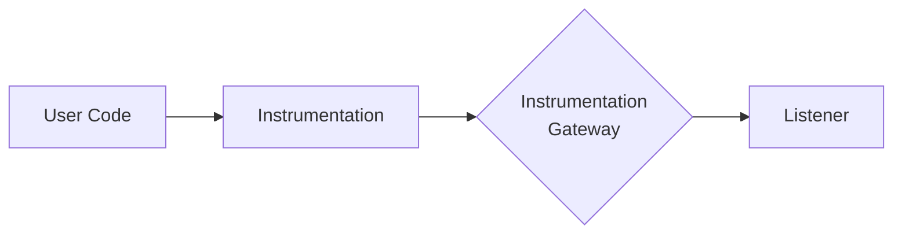
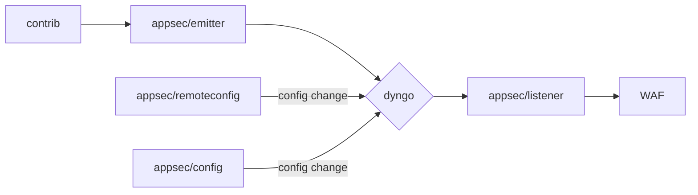
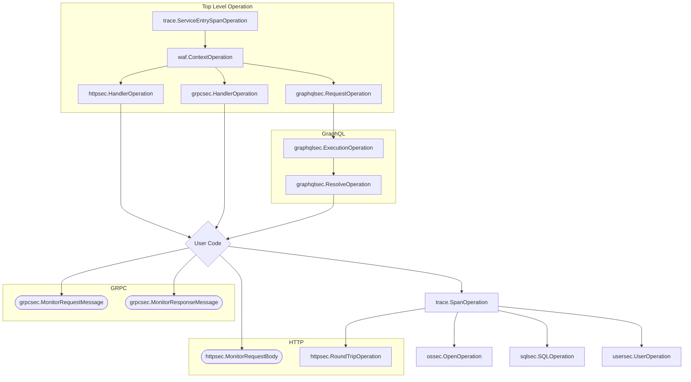
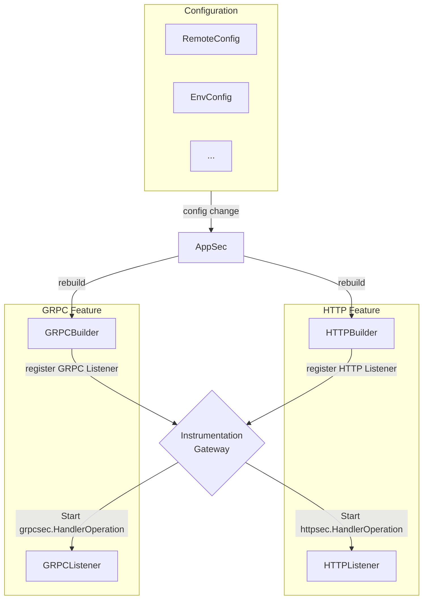

# Appsec Go Design

This document describes the design of the `internal/appsec` package and everything under it. This package is responsible
for securing the application by monitoring the operations that are executed by the application and applying actions in
case a security threats is detected.

Most of the work is to forward information to the module `github.com/DataDog/go-libddwaf` which contains the WAF
(Web Application Firewall) engine. The WAF does most of the decision making about events and actions. Our goal is to
connect the different parts of the application and the WAF engine while keeping up to date the various sources of
configuration that the WAF engine uses.

### Instrumentation Gateway: Dyngo

Having the customer (or orchestrion) instrument their code is the hardest part of the job. That's why we want to provide
the simplest API possible for them to use. This means loosing the flexibility or enabling and disabling multiple
products and features at runtime. Flexibility that we still want to provide to the customer, that's why behind every
API entrypoint present in `dd-trace-go/contrib` that support appsec is a call to the `internal/appsec/dyngo` package.



Dyngo is a context-scoped event listener system that provide a way to listen dynamically to events that are happening in
the customer code and to react to configuration changes and hot-swap event listeners at runtime.



### Operation definition requirements

* Each operation must have a `Start*` and a `Finish` method covering calls to dyngo.
* The content of the arguments and results should not require any external package, at most the standard library.

Example operation:

```go
package main

import (
	"context"

	"github.com/DataDog/dd-trace-go/v2/instrumentation/appsec/dyngo"
	"github.com/DataDog/dd-trace-go/v2/internal/log"
)

type (
	ExampleOperation struct {
		dyngo.Operation
	}

	ExampleOperationArgs struct {
		Type string
	}

	ExampleOperationResult struct {
		Code int
	}
)

func (ExampleOperationArgs) IsArgOf(*ExampleOperation)      {}
func (ExampleOperationResult) IsResultOf(*ExampleOperation) {}

func StartExampleOperation(ctx context.Context, args ExampleOperationArgs) *ExampleOperation {
	parent, ok := dyngo.FromContext(ctx)
	if !ok {
		log.Error("No parent operation found")
		return nil
	}
	op := &ExampleOperation{
		Operation: dyngo.NewOperation(parent),
	}
	return dyngo.StartOperation(op, args)
}

func (op *ExampleOperation) Finish(result ExampleOperationResult) {
	dyngo.FinishOperation(op, result)
}
```

> [!CAUTION]
> Importing external packages in the operation definition will probably cause circular dependencies. This is because
> the operation definition can be used in the package is will instrument, and the package that will instrument it will
> probably import the operation definition.

### Operation Stack

Current state of the possible operation stacks



> [!IMPORTANT]
> Please note that this is how the operation SHOULD be stacked. If the user code does not have a Top Level Operation
> then nothing will be monitored. In this case an error log should be produced to explain thoroughly the issue to
> the user.

### Features

Features represent an abstract feature added to the tracer by AppSec. They are the bridge between the configuration and
its sources
and the actual code that needs to be ran in case of enablement or disablement of a feature. Features are divided in two
parts:

- The builder that should be a pure function that takes the configuration and returns a feature object.
- The listeners that are methods of the feature object that are called when an event from the Instrumentation Gateway is
  triggered.

From there, at each configuration change from any config source, the AppSec module will rebuild the feature objects,
register the listeners to the Instrumentation Gateway, and hot-swap the root level operation with the new one,
consequently making the whole AppSec code atomic.

Here is an example of how a system with only two features, GRPC and HTTP WAF Protection, would look like:



All currently available features are the following ones. Each feature is identified by a name (a slug, defined in
the `listener` package and returned by the feature's `String()` method):

| Name      | Feature                | Description                                            |
|-----------|------------------------|--------------------------------------------------------|
| `http`    | HTTP WAF Protection    | Protects HTTP requests from attacks                    |
| `grpc`    | GRPC WAF Protection    | Protects GRPC requests from attacks                    |
| `graphql` | GraphQL WAF Protection | Protects GraphQL requests from attacks                 |
| `sqli`    | SQL RASP               | Runtime Application Self-Protection for SQL injections |
| `lfi`     | OS RASP                | Runtime Application Self-Protection for LFI attacks    |
| `cmdi`    | CMDi RASP              | Runtime Application Self-Protection for command injection attacks |
| `ssrf`    | HTTP RASP              | Runtime Application Self-Protection for SSRF attacks and downstream request analysis |
| `user`    | User Security          | User blocking and login failures/success events        |
| `waf`     | WAF Context            | Setup of the request scoped context system of the WAF  |
| `trace`   | Tracing                | Bridge between the tracer and AppSec features          |

`DD_APPSEC_DISABLE_FEATURES` takes a comma-separated list of feature names (case-insensitive) that must not be
started, e.g. `DD_APPSEC_DISABLE_FEATURES=http,grpc`. The `waf` and `trace` features are required by every other
feature and cannot be disabled. Unknown names are ignored with a warning log. Because HTTP bodies, HTTP route parameters
and gRPC messages reach the WAF context without going through the `http` and `grpc` listeners, disabling those features
also removes their WAF addresses from the supported addresses, so the WAF never evaluates them.

### Error Tracking eligibility

The AppSec package marks each `log.Error` and `log.Warn` site with an
`//errtrack:ignore` directive when the logged failure is not eligible for Error
Tracking reporting. The directive carries the reason, so an audit does not have
to re-derive it from the code.

A site is ineligible only when its failure is outside the SDK's control or is
reported through another channel:

- The caller used the AppSec API while AppSec is disabled, or without the
  request instrumentation that the API requires. These failures depend on the
  application, not on the SDK.
- The failure comes from a user-provided value, such as a blocked-response
  template path.
- The failure comes from the host or the native library, such as a
  libddwaf compatibility issue on the host.
- The failure is an expected limit on the request path: the global trace rate
  limit (`DD_APPSEC_TRACE_RATE_LIMIT`) or the maximum number of WAF events per
  request.
- Remote Config reports the failure back to the backend through an apply
  status. Only a site that always produces an apply status may use this reason.

A site without a directive stays actionable in the audit. Do not add a
directive to hide an unclassified site; remove or fix the site instead.

Startup timing is not a reason to leave a site unclassified. A report made
before `telemetry.StartApp` captures its stack trace eagerly at the call site
and is replayed once telemetry starts, so the stack still points at the real
call site. The failure mode to watch for is eviction from the 512-entry ring
buffer shared by every global telemetry call, not a bad stack trace. Prefer a
site that fires after `StartApp` when you have the choice; see the reporting
policy in [internal/README.md](../README.md) for the full criteria.

### AppSec state checks

`Enabled` and `RASPEnabled` load the active AppSec instance and its started state
atomically. Query hooks do not take the lifecycle mutex. Instance replacement
remains serialized, and remote activation updates the instance's atomic state.

### SQL monitoring in pgx

The native pgx integration only monitors SQL; it cannot block it. See
[contrib/jackc/pgx.v5/README.md](../../contrib/jackc/pgx.v5/README.md#appsec-sql-injection-monitoring)
for its behavior and limitations.

### Block outcome telemetry

Tests that inspect WAF telemetry should install `testutils.StartTelemetryRecorder`
before starting AppSec. This isolates the recorded metrics from submissions
buffered by earlier tests while preserving exact request-count assertions.

The `waf.requests` metric has one data point for each WAF context. Two of its
tags show the block outcome of the request:

| `request_blocked` | `block_failure` | Meaning                                              |
|-------------------|-----------------|------------------------------------------------------|
| `false`           | `false`         | No WAF-scope `block_request` action was returned.    |
| `true`            | `false`         | A block was requested and enforced.                  |
| `false`           | `true`          | A block was requested, but it could not be enforced. |

The `ContextMetrics` type in `emitter/waf/metrics.go` records the outcome:

- `runWAF` calls `SetBlockRequested` when the WAF returns a WAF-scope
  `block_request` action. RASP-scope actions do not change these tags.
- `SetBlockFailed` records that the block was not enforced. `runWAF` calls it
  when the action cannot be built. Integrations call it when they cannot deliver
  the block response, for example because the response has already started, or
  because a block callback or the block response panicked.
- `SetBlockApplied` records that a block response was applied. The HTTP
  integration calls it when the block response was delivered.
- The HTTP integration reports a failure or an application only for the block
  that the WAF-scope `block_request` created. `runWAF` marks that block with
  `actions.Config.ReportBlockOutcome`, and `BlockHTTP.ReportsBlockOutcome`
  returns true for it. A redirect or a RASP-scope block uses the same
  `BlockHTTP` type, but its outcome does not change these tags. Thus, an
  applied redirect cannot hide a WAF block that failed.
- If a block panics before `httpsec.BeforeHandle` returns, the caller cannot
  run `afterHandle`. `BeforeHandle` then finishes the operation and the WAF
  context before the panic continues, so `waf.requests` is still submitted.
- `Submit` resolves the two tags at the end of the WAF context. A requested
  block counts as enforced unless a failure was reported. Thus, an integration
  that does not report its outcome keeps the previous behavior. An applied block
  has precedence: a failure that a later action reports does not change it.

RASP rules report their block outcome on `rasp.rule.match` with the
`block:success`, `block:failure`, or `block:irrelevant` tag.

A monitor-only run (`SubcontextOperation.RunMonitorOnly`, used by the pgx SQL
monitoring) removes the `block_request` and `redirect_request` actions. It
reports a removed `block_request` as `block:failure` on `rasp.rule.match`. It
does not count as a requested block on `waf.requests`, so it cannot hide a
later block of the same request.

### WAF error telemetry

`ContextMetrics.IncWafError` (`emitter/waf/metrics.go`) reports the errors that
`Context.Run` returns. A timeout (`waferrors.ErrTimeout`) is not an error: it
does not get an error code. `RegisterWafRun` counts timeouts. A timeout never
hides a real error: a real error is reported even when the same run also timed
out.

The `waf_error` tag of `waf.error` and `rasp.error`, and the span tags
`_dd.appsec.waf.error` and `_dd.appsec.rasp.error`, hold the `ddwaf_run` return
code (RFC-1012). `waferrors.ToWafReturnCode` (go-libddwaf v5.1.0 and later)
gives the code of the error that a run returned: `-3`, `-2` or `-1` for the
three `ddwaf_run` errors, `-127` for any other error (an error from the
bindings), and `0` when there is no error to report (a `nil` error, or only
timeouts):

| Error from `Run` | Code |
|------------------|------|
| `ErrInternal` | `-3` |
| `ErrInvalidObject` | `-2` |
| `ErrInvalidArgument` | `-1` |
| Any other error (`ErrOutOfMemory`, `ErrEmptyRuleAddresses`, `ErrContextClosed`, encoder errors, ...) | `-127` (error from the bindings) |

- The boolean `waf_error` tag of `waf.requests` is not a code. It is `true`
  when `Run` returned a real error (`waferrors.ToWafReturnCode` is not zero),
  also when the same run timed out.
- The span tags hold one code per request: the code closest to zero (the least
  negative). `updateClosestToZero` keeps it, and ignores a code that is not
  negative. Zero means no error. The RASP tag is the closest code over all rule
  types.
- `AddWAFMonitoringTags` sets `_dd.appsec.waf.error` only when `WAFErrorCode`
  is not zero, and `_dd.appsec.rasp.error` only when one `RASPErrorCodes` entry
  is not zero.

### Rate limit telemetry and trace keep

The AppSec trace rate limit (`DD_APPSEC_TRACE_RATE_LIMIT`) limits the WAF force-keeps
(`ManualKeep`). It never removes events. The Node.js and Python tracers use the same model.

- `ContextOperation.AddEvents` stores the events of a WAF or RASP run, and it never calls the
  limiter. A request accepts no new batch once it has 10 stored events. This cap does not use a token.
- A WAF or RASP result with `keep=true` calls the limiter through `allowKeep`, also when the cap
  drops its events. A result without `keep` never calls the limiter. When the limiter allows,
  the run sets `ManualKeep`.
- Difference from Node.js and Python: after the first success, the request makes no more limiter
  calls (`wafKeepAdmitted`). Later `keep` runs set `ManualKeep` again with no token. The flag does
  not tell the sampling priority.
- `rate_limited:true` on `waf.requests` means that a `keep` run (WAF or RASP) was denied by the
  limiter. A request that only reaches the cap of 10 stored events gives `rate_limited:false`.
- A denied `keep` run keeps its events. They reach the backend when any other source keeps the
  trace: the sampler, the first-request rules keep, or the API Security schema keep. So the limiter
  is not a global limit on the traces that have events.

### Late blocks and route reports in HTTP contribs

An HTTP contrib can learn the route of a request after the handler ran (go-chi
with `Use` before routing). It then calls `httpsec.RouteMatched(ctx, route, nil)`.
With no path parameters, the call sends no data to the WAF: it causes no
additional native WAF evaluation, so there is no new match or event, no use of
the request budget or of the event limit, and a stored action is not replaced.
API Security uses the route as the sampling key.

A block or a redirect that the WAF stored replaces the response only if the
response is not sent yet. It never stops the handler. The integration tells
`httpsec` if the response is sent through the response writer (`Committed()`). If
it is sent, the bytes do not change: the block is a `block_failure`, and a redirect
is not counted as a block (see [Block outcome telemetry](#block-outcome-telemetry)).

go-chi details are next to the code: the route timing and the WAF input in
`contrib/go-chi/*/appsec.go`, and how the commit tracker sees a sent response in
`contrib/go-chi/*/writer_appsec.go`.

### Normalized route

When API Security is enabled and the HTTP WAF feature of `listener/httpsec` runs,
it sets `_dd.appsec.normalized_route` (RFC-1125) when the response is reported: the
route of the request as an OpenAPI path template, such as `/users/{id}`. It is
computed with the grammar of the framework that started the
`httpsec.HandlerOperation` (`normalized_route.go`) from `HandlerOperation.MatchedRoute`:
the route, its path parameters, and the path that the router matched. An unknown
framework or a route that cannot be expressed as segments and parameters gets no
tag.

The route must come from a router. By default it is the route of the operation,
after any `RouteMatched` call, with its path parameters. `httptrace.BeforeHandle`
uses a route inferred from the request URL as the API Security sampling key when
the integration has no route, and sets `httpsec.Config.RouteInferred` for it: such
a route gets no tag. An integration whose operation route is not the router's own,
or that learns the route after the handler started, reports it with
`httpsec.ReportMatchedRoute`, which is for API Security only: no WAF evaluation,
and the sampling key is unchanged. A report of no route gets no tag.
- go-chi reports the route from `RoutePatterns`, which keeps a declared trailing
  `/` and is not renamed by `WithModifyResourceName` (go-chi v5), with the
  parameters of the selected route. It reports the route that chi knows when the
  middleware starts, for an early block, and the selected route after the handler,
  also when it panics. A request that stops at a mounted chi router with no route
  for it gets the route of the mount, but with OpenTelemetry semantics, where it
  gets no `http.route` and no route. chi clears the `*` of a mount, which is the
  `*` of the route when the mounted handler is not a chi router: its value is the
  rest of the routed path that chi gives that handler (`RoutePath`), so a
  middleware that rewrites the routing path is followed. A route that ends with
  `*` keeps the value that chi bound, also an empty one. `RoutePath` tells the
  two apart, and the route table of the router when the mount leaves the text
  that the route would have matched.
- net/http reports the pattern that `ServeMux.Handler` returns and the path that
  ServeMux matches, before AppSec can block the request, also for a route
  registered on a caller-provided `*http.ServeMux`, which reports no path
  parameters to the WAF. A `{name...}` wildcard is present when its path value
  is not empty, or without one, when the rest of that path is not empty. A
  redirect that ServeMux generates gets the pattern that it leads to, but for the
  trailing-slash redirect of a CONNECT request, whose pattern is the redirect
  path: it gets no route. A request that ServeMux answers without a pattern
  (`*`), and every request with the matcher of `GODEBUG=httpmuxgo121=1`, whose
  patterns are literal paths, get no route. `WrapHandler` inside a ServeMux
  reports the pattern that the ServeMux matched, with its path values.
- fiber reports the last route that it ran, also for a blocked request, with the
  path that it matched (`c.Path()`) and `UnescapePath`. Without `StrictRouting`,
  a prefix route matches without its trailing `/`, as fiber matches it.
- gorilla/mux reports no route when a subrouter's 404 or 405 handler answers:
  gorilla matches the request with the prefix route of the subrouter.
- echo marks the path of its router's 405 and OPTIONS answers as no route
  (`httpsec.Config.RouteInferred`): it is the path of a route for another method.

gin and fiber bind every parameter of their route, so a `:` starts a parameter
only when the router bound it: gin (v1.11+) reports an escaped `\:` as `:`, and
fiber does not parse the prefix of `Static`. A parameter name that the route
repeats gets a numeric suffix, and fiber, which binds one value per name, leaves
out a repeated optional parameter.

By default, the path that the router matched is the escaped path of the request
URL that `httpsec.BeforeHandle` gets, as the router reads it (`URL.RawPath` when
net/http sets it), so a handler before the router that rewrites it
(`http.StripPrefix`) is followed.

Every Go integration that sets the tag resolves the presence of its optional parts:
an optional parameter or a catch-all is in the tag only when its path parameter
has a non-empty value, and a rest of the path that is empty or only `/`, in the
form that the router matched, is an absent catch-all. When the parameter has no value, or a prefix catch-all below
cannot be found, it is left out: the fallback that RFC-1125 allows.

A prefix route has an implicit catch-all: the rest of the path after the part that
the route matched. Routers report a prefix route as its template, so the listener
rebuilds that part from the route's static text and the values that the router
bound to its parameters:
- gorilla/mux `PathPrefix`: gorilla matches the unescaped path, or the escaped
  path with `UseEncodedPath`, which the integration cannot read. The part is
  looked for in the unescaped path, then in the escaped path: gorilla matched the
  escaped path only when the unescaped one does not start with the part. A `Path`
  route matches the whole path, so it has no rest.
- fiber `Use`, `Static` and mounts: the part starts the path that fiber matched,
  ignoring case. A route that ends with `*` or `+` takes the rest of the path.

Without the value of a parameter, or when the path does not start with the part,
the route gets no catch-all.

The `%XX` in the static text of a route are escaped bytes only when the router
matches the escaped path: always for net/http, for fiber without `UnescapePath`,
for go-chi and echo v4 when net/http sets `URL.RawPath`, and for gorilla/mux when
the escaped path is the one found above. When the setting that decides it cannot
be read otherwise (gorilla/mux `UseEncodedPath`, echo v5
`UseEscapedPathForMatching`), `%` is static text and is encoded as `%25`.

fiber reports no route when its router found none: the last route is then a
middleware, which answers the router's 404 (its message names the method and the
path) or a 405 with `Allow`. The WAF still gets the parameters of that middleware.
An endpoint that returns its own 404 or 405 keeps its route, and so does a prefix
handler (`Use`) that returns another error. A prefix handler that returns the
router's 404, or sets `Allow` and answers 405, cannot be told from a middleware
before a router miss: it gets no route.
fiber also reports no route when a middleware without a path prefix answers
another path than `/` with an error: it answered before routing, or after a
router miss whose error it handled.
